# ERD 예시: smsdb skeleton (smsdb)

출처: `java-late-catcher/src/main/resources/db/schema.sql`, `skeleton/model/Member.java`, `Membership.java`

ERDCloud 방식: 엔티티는 `논리명 (물리명)`, 컬럼은 `타입 물리명 키 "논리명 | NULL | 기본값"`

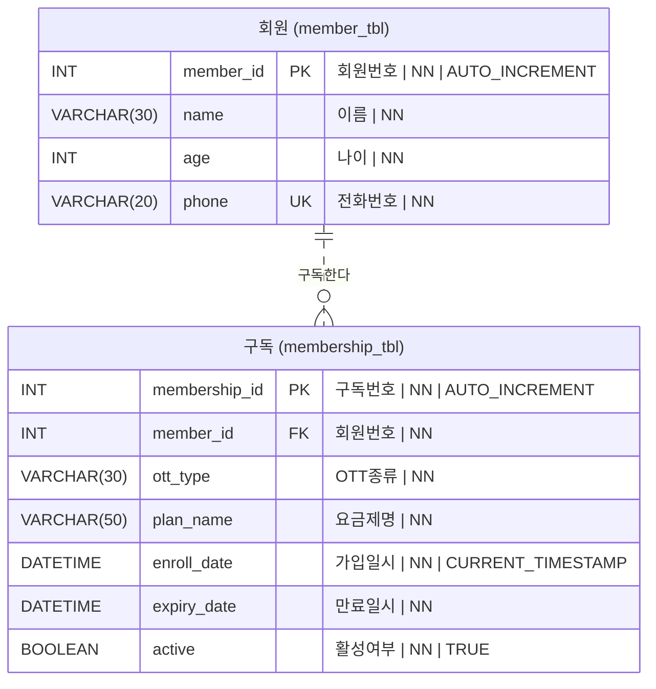

## 엔티티 정의서 (ERDCloud 컬럼 형식)

### 회원 (member_tbl)

| 키 | 논리명 | 물리명 | 타입 | NULL | 기본값 | 코멘트 |
| --- | --- | --- | --- | --- | --- | --- |
| PK | 회원번호 | member_id | INT | NN | AUTO_INCREMENT | |
| | 이름 | name | VARCHAR(30) | NN | | |
| | 나이 | age | INT | NN | | |
| UK | 전화번호 | phone | VARCHAR(20) | NN | | 중복 불가 |

### 구독 (membership_tbl)

| 키 | 논리명 | 물리명 | 타입 | NULL | 기본값 | 코멘트 |
| --- | --- | --- | --- | --- | --- | --- |
| PK | 구독번호 | membership_id | INT | NN | AUTO_INCREMENT | |
| FK | 회원번호 | member_id | INT | NN | | member_tbl.member_id 참조 |
| | OTT종류 | ott_type | VARCHAR(30) | NN | | |
| | 요금제명 | plan_name | VARCHAR(50) | NN | | |
| | 가입일시 | enroll_date | DATETIME | NN | CURRENT_TIMESTAMP | |
| | 만료일시 | expiry_date | DATETIME | NN | | |
| | 활성여부 | active | BOOLEAN | NN | TRUE | |

## 관계 읽는 법

`MEMBER_TBL ||..o{ MEMBERSHIP_TBL`

| 위치 | 기호 | 의미 | 근거 |
| --- | --- | --- | --- |
| MEMBER 쪽 | `\|\|` | 필수, 1 | `membership_tbl.member_id`가 `NOT NULL` → 구독은 반드시 회원 1명에 속함 |
| MEMBERSHIP 쪽 | `o{` | 선택, N | 회원은 구독이 0개일 수도, 여러 개일 수도 있음 |
| 선 | `..` (점선) | 비식별 관계 | FK `member_id`가 PK(`membership_id`)에 포함되지 않음 |

## Mermaid 기호 정리

| 왼쪽 | 오른쪽 | 의미 |
| --- | --- | --- |
| `\|\|` | `\|\|` | 정확히 1 (필수) |
| `\|o` | `o\|` | 0 또는 1 (선택) |
| `}\|` | `\|{` | 1 이상 (필수, N) |
| `}o` | `o{` | 0 이상 (선택, N) |

- 선에 붙은 기호 = 최소(`o` 선택 / `\|` 필수), 엔티티에 붙은 기호 = 최대(`\|` 1 / `{` N)
- `--` 실선 = 식별 관계(FK가 자식 PK에 포함), `..` 점선 = 비식별 관계

# --------------------

# 데이터베이스: 논리적 모델링
## 정규형
1) 제1정규형(1NF) (First Normal Form)
- 테이블 내의 모든 속성(컬럼)이 원자값(atomic value)만을 가지도록 테이블을 설계하는 정규화의 첫번째 단계
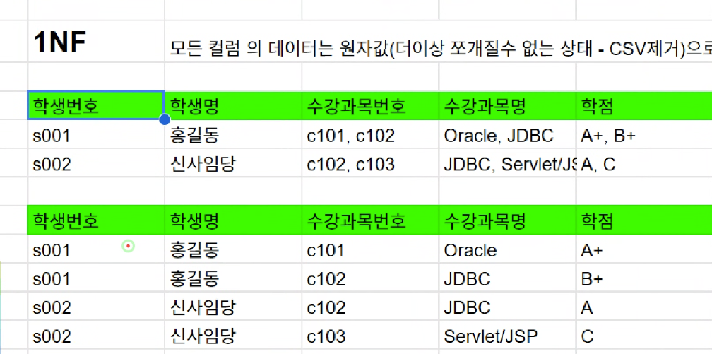

2) 제2정규형(2NF)
- 제2정규형은 제1정규형을 만족하는 테이블에서 **부분적 함수 종속**을 제거하는 과정이다. 
- 기본키가 두 개 이상의 속성으로 구성되어 있을 때 
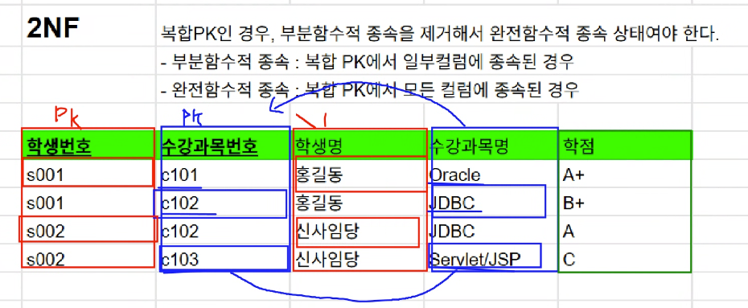
수강과목명은 수강과목 번호에 부분적 함수 종속임

학점은 학생번호와 수강과목 번호에 완전함수적 종속으로 만들어줘야 함
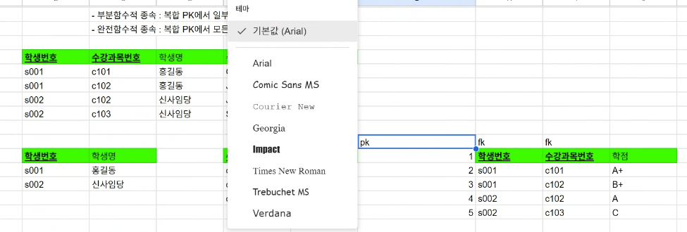

## 엔티티 관계 (카디널리티)
### 1:1
 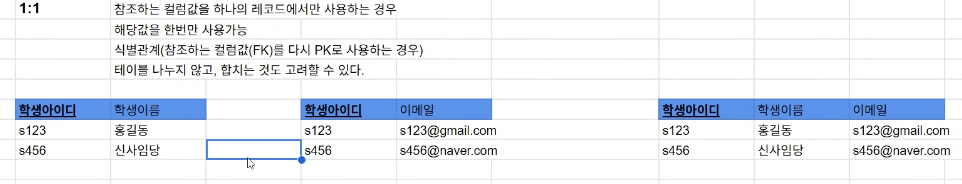
(합칠 수 있다)

### 1:N 
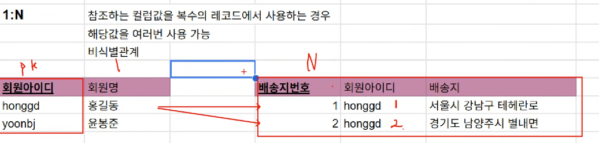

### N:M
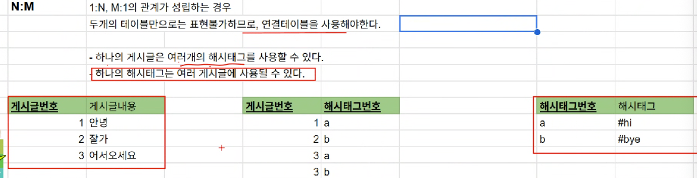
- 두 개의 테이블만으로는 표현불가하므로, 연결 테이블을 사용해야 한다. 

### 식별 관계 vs 비식별 관계 (`--` 실선 vs `..` 점선)

핵심: **부모의 PK가 자식의 PK에 포함되는가?**

| | `--` 실선: **식별 관계** | `..` 점선: **비식별 관계** |
| --- | --- | --- |
| 부모 PK가 자식에서 | 자식 **PK의 일부** (동시에 FK) | 자식의 **일반 컬럼** (FK일 뿐) |
| 부모 없이 자식 행을 식별할 수 있나? | 없다. 부모 키가 자식의 신원 일부 | 있다. 자식에게 자기 PK가 따로 있음 |
| 오늘 예시 | 온라인강의: PK `(과목명, 강사코드)`. 강의 하나를 가리키려면 강사코드가 필요 | 주문: PK `주문번호`. `고객ID`는 누가 주문했는지만 알려줌 |
| FK가 NULL일 수 있나? | 불가. PK 컬럼은 NULL이 될 수 없음 | 허용하면 가능. 그러면 관계가 선택(`o\|`)이 됨 |

- **판별법**: 자식의 PK를 본다. FK가 PK에 들어 있으면 실선 `--`, 아니면 점선 `..`
- **실무에서의 차이**
  - 식별 관계는 키가 계속 쌓인다. 온라인강의의 자식(예: 수강신청)이 생기면 그 PK에도 `(과목명, 강사코드)`가 따라 내려간다.
  - 비식별 관계가 더 유연하다. 그래서 실무에서는 테이블마다 자체 ID 컬럼을 두고 점선으로 연결하는 경우가 많다.
- Mermaid는 내가 쓴 선 모양을 그대로 그릴 뿐, 키 구성과 맞는지 검사하지 않는다.

3) 제3정규형 (3NF)
- 기본키가 아닌 속성(비주요속성)이 다른 비주요 속성에 종속되는 **이행적 함수 종속**을 제거하는 과정

** 보통은 3정규화 정도까지만 실행한다. 

## 정규화와 성능의 균형

### 제2차 정규화 실습

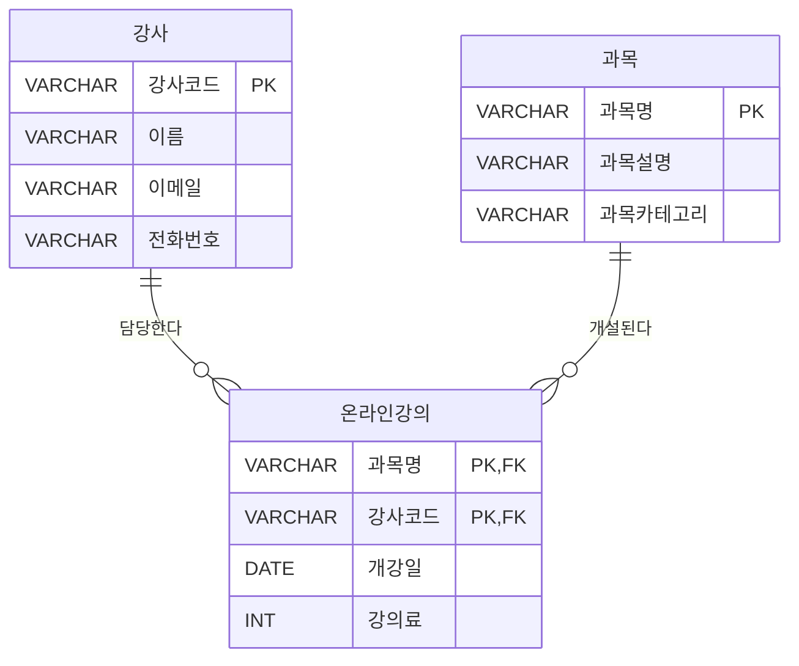

### 제3차 정규화 실습
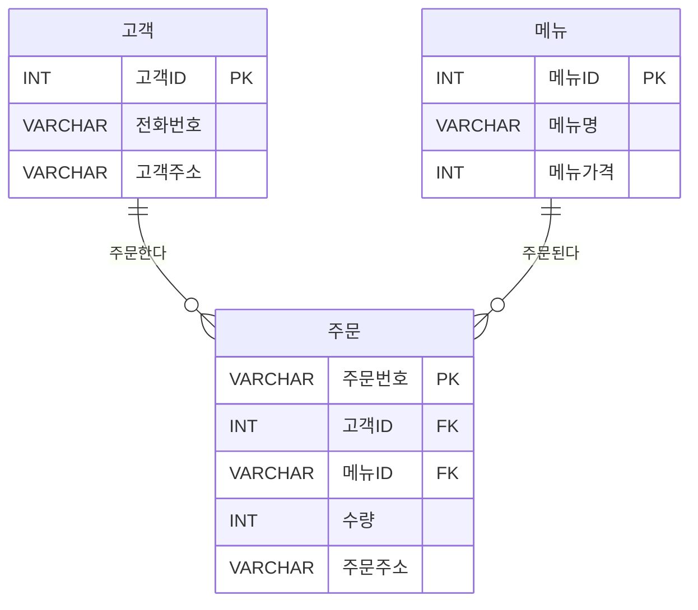

#### 상세 버전 (컬럼 정보 추가)

컬럼 형식: `타입 컬럼명 키 "NULL 여부 | 기본값 | 설명"`

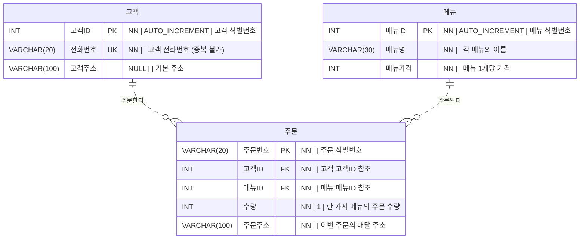

#### Claude 답안

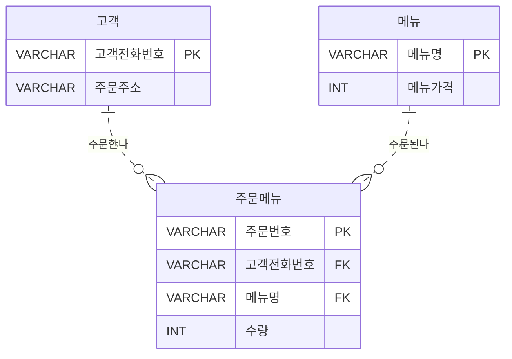

### 팀 프로젝트1
기능 목록 - 스켈레톤 참조 + 추가 상세 기능 가능  << 요구사항 명세 (기능 명세)
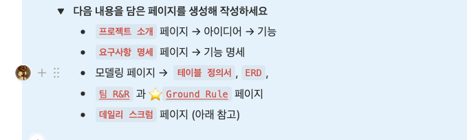
<< 노션에 작성>>

데일리 스크럼
- 1. 오늘 어떤 작업을 할 건지
- 2. 오늘 작업에 어떤 문제가 있었는지