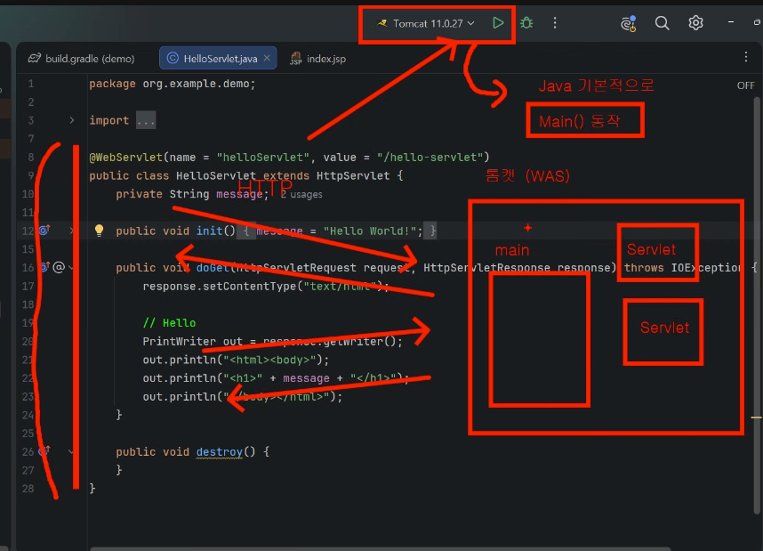
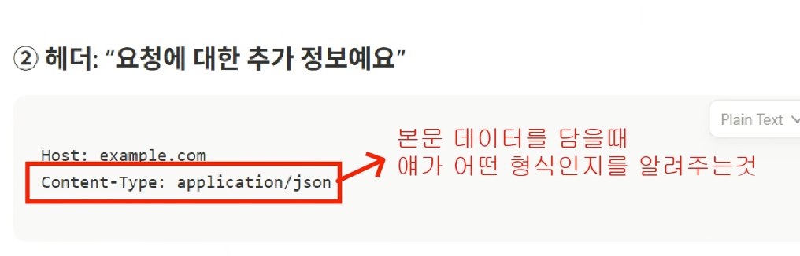
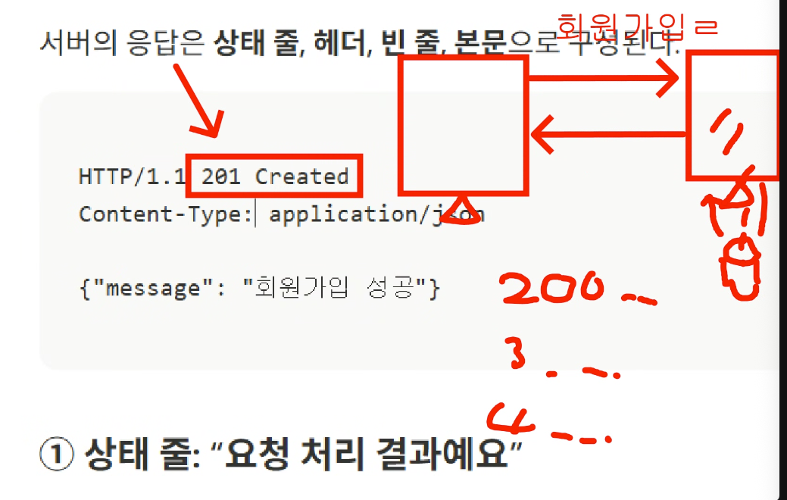
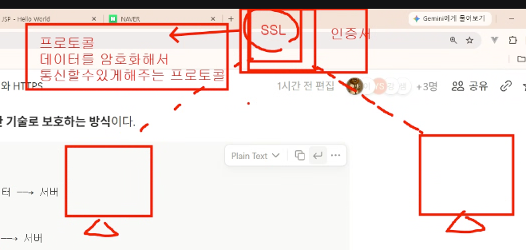
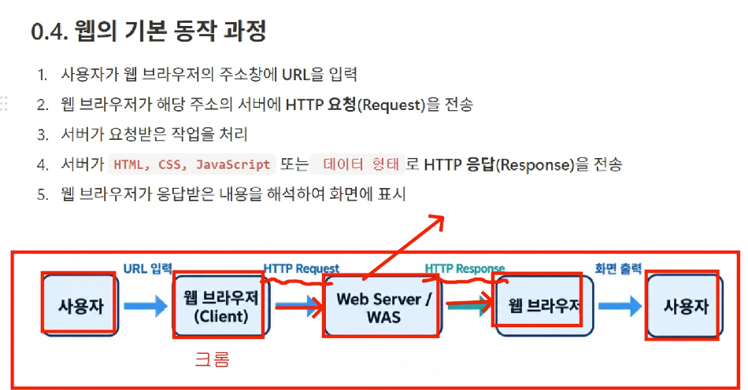
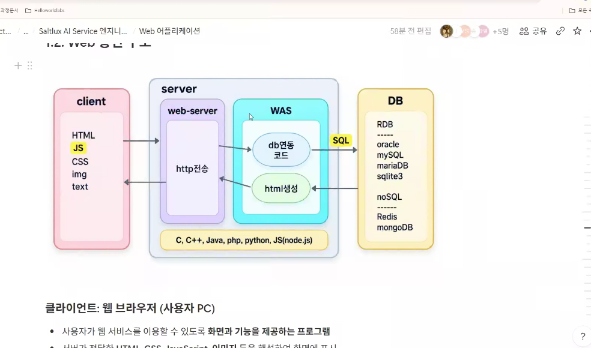
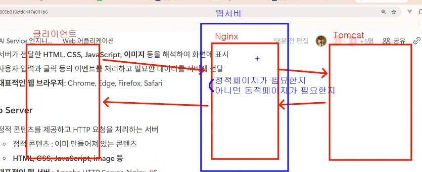
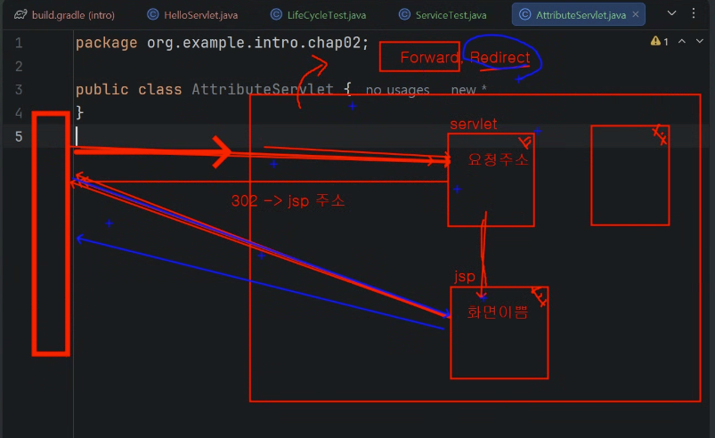
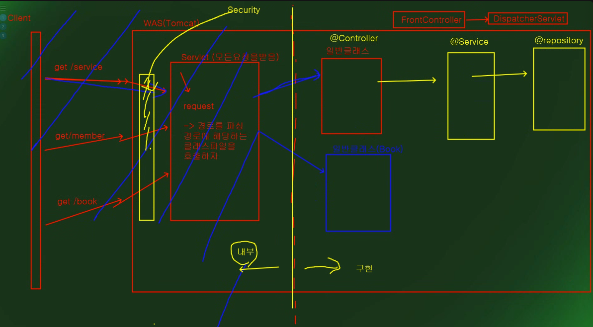
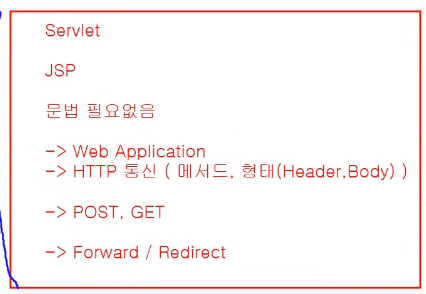

# 수업 내용

2026년 10월 28일 웹 기초와 Servlet·JSP
웹과 HTTP
웹 서버·WAS의 역할과 요청·응답 구조
HTTP 메서드·상태 코드와 HTTPS
Servlet과 JSP
서블릿 매핑·핵심 API·생명주기
JSP 실행 과정
MVC와 요청 처리
Model·View·Controller의 역할
Forward와 Redirect의 차이
FrontController의 요청 분기와 화면 연결

## 웹을 구성하는 핵심 기술
HTML
CSS
JavaScript
URL

https://www.example.com/product/list

빨간색(http) : 통신방식 (프로토콜) -> 브라우저가 서버가 통신할때 사용하는 규칙
파란색(www.example.com) : 도메인 -> 접속하려는 서버를 식별하려는 주소
노란색(product/list) : 자원경로 (Path) -> 서버 안에서 요청하려는 페이지나 자원의 위치

REST API > RESTFull API

HTTP REQUEST:
>   **POST / members HTTP/1.1**
    host: example.com // 헤더: 요청을 보낼 서버
    Content-Type: application/json // http는 헤더에 요청줄, 부가정보가 있음, 본문에 담긴 데이터의 형식
    {"name": "홍길통"} (key-value)

HTTP Method:
자주 사용하는 메서드는 다음과 같다.

메서드	주로 사용하는 목적	예시
GET	조회	게시글 목록 조회
POST	데이터 제출·등록	회원가입
PUT	전체 교체	회원 정보 전체 교체
PATCH	일부 수정	닉네임 변경
DELETE	삭제	게시글 삭제

### 서버의 응답은 상태 줄, 헤더, 빈 줄, 본문으로 구성된다. 
HTTP/1.1 201 Created // 상태 코드 (200, 300, 400)

- 200: ok
- 201: created
- 400: bad request
- 404: Not found
- 500: Internal server error

MDN (https://developer.mozilla.org/ko/docs/Web/HTTP/Reference/Status)

### HTTPS는 왜 필요할까?
HTTPS에서도 요청과 응답의 기본 개념은 같다. 그 내용을 주고받는 통신에 보안 기능이 더해진 것이다.
- 암호화
- 변조 탐지
- 서버 인증

* SSL : 인증서

### 웹의 기본 동작 과정

정적 웹(Static Web)
- **예시**: 회사 소개 페이지, 공지 문서
- **주요 콘텐츠**: HTML, CSS, JavaScript, 이미지

동적 웹(Dynamic Web)
- **예시**: 로그인, 게시판, 상품 검색, 주문 처리
- **주요 기술**: Servlet, JSP, Spring, 데이터베이스

클라이언트 - 웹서버 (Nginx) - WAS(Tomcat)
* 웹서버는 정적 페이지를 응답하면서 동시에 정적페이지가 필요한지, 동적 페이지가 필요한지 판단도 해 줌

WAS핵심기능
- 웹 컨테이너
- 트랜잭션 관리
- 커낵션 풀
- 보안처리

** Tomcat은 웹서버와 WAS역할을 겸직할 수 있음

**Servlet 컴포넌트** 

- **역할**: HTTP 요청을 처리하는 자바 클래스
- **특징**: 비즈니스 로직 중심, 프로그래밍 방식
- **예시**: 로그인 처리, 데이터 조회, API 응답

**JSP 컴포넌트** 

- **역할**: 동적 웹 페이지 생성하는 템플릿
- **특징**: HTML 중심, 화면 표시 중심
- **예시**: 게시판 목록, 상품 상세 페이지

**웹 컨테이너**
- 웹 컴포넌트 (JSP)

##
JSP의 이해 (Java Server Page)
- **태그 기반 웹 컴포넌트**: `.jsp` 확장자를 가진 태그 기반의 웹 컴포넌트
- **동적 실행**: 클라이언트의 요청에 의해 동적으로 실행
- **자동 서블릿 변환**: 자동으로 서블릿으로 변환되어 실행
- **MVC 패턴 View 역할**: MVC 패턴에서 View 역할

서블릿: 자바코드안에 html
jsp: html 코드 안에 java

Forward / Redirect

client

get/service

WAS(Tomcat)
- Servlet (모든 요청을 받음)
- - request
> 경로를 파싱: 경로에 해당하는 클래스 파일을 호출하자. 

Servlet이 일반 클래스를 처리함

>> FrontControlllerPattern
>>> DispatcherServlet

프런트 컨트럴처(1차) Dispatcher Servlet << 모든 요청을 받음>>

Servlet
JSP 
Web Application 
HTTP 통신 메서드, 프로토콜의 형태(Header, Body)
POST, GET의 차이

Forward / Redirect 개념 중요

