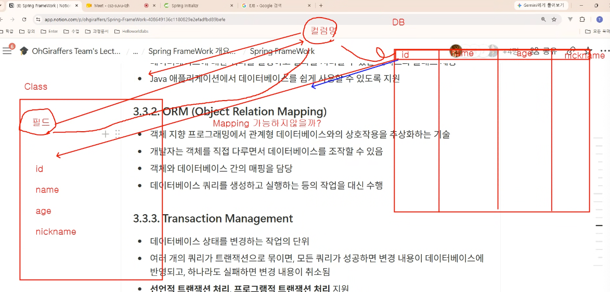
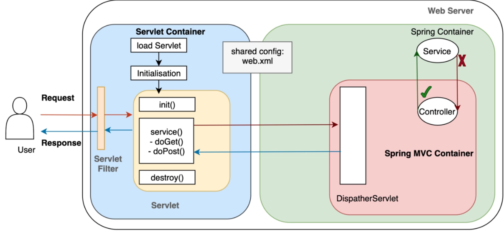
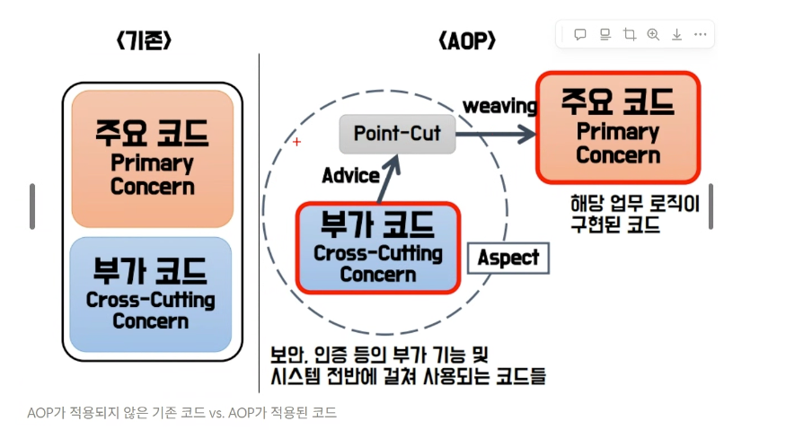
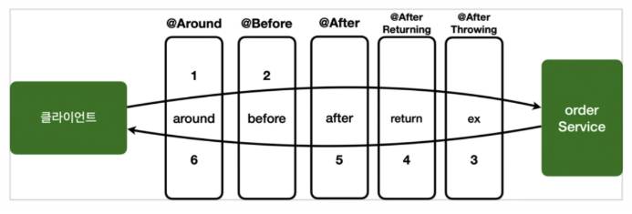

# 수업 내용

2026년 10월 29일 Spring Framework 핵심 개념
- Spring Framework
- IoC : IoC Container
- DI : Dependency Injection
- AOP : Aspect Oriented Programming


## 1. Spring Framework (스프링 프레임워크)
- 자바 엔터프라이즈 애플리케이션을 만들기 위한 오픈소스 **경량 프레임워크** (lightweight framework)
- **POJO** (Plain Old Java Object): 특정 기술에 묶이지 않은 평범한 자바 객체로 개발할 수 있게 해 줌
- 스프링의 3대 핵심: **IoC/DI**, **AOP**, **PSA** (Portable Service Abstraction, 이식 가능한 서비스 추상화)
- 라이브러리 vs 프레임워크
  - 라이브러리 (Library): **내 코드가** 라이브러리를 호출
  - 프레임워크 (Framework): **프레임워크가** 내 코드를 호출 → 이것이 IoC
  - > "Don't call us, we'll call you." (Hollywood Principle)
- Spring Boot: 스프링 설정을 자동화 (Auto-configuration)하고 내장 서버 (Embedded Tomcat)를 제공


## 2. IoC : Inversion of Control (제어의 역전)
- 객체의 **생성 · 생명주기 · 의존관계 관리**의 제어권이 개발자 → **컨테이너**로 넘어감
- 어제 배운 Servlet도 같은 개념: `new`로 만들지 않아도 Tomcat (Servlet Container)이 생성하고 `init()` → `service()` → `destroy()`를 호출함

**IoC Container (= Spring Container)**
- Bean을 생성하고, 의존관계를 연결하고, 생명주기를 관리하는 컨테이너
  - `BeanFactory`: 가장 기본 컨테이너, Bean을 요청할 때 생성 (lazy loading)
  - `ApplicationContext`: `BeanFactory`를 확장 (메시지, 이벤트, 환경설정 등), 실무에서 주로 사용

**Bean (빈)**
> "A bean is an object that is instantiated, assembled, and managed by a Spring IoC container." (Spring Docs)
- 스프링 컨테이너가 만들고 관리하는 객체
- 등록 방법: `@Component` (+ `@ComponentScan`), `@Configuration` + `@Bean`, XML 설정


## 3. DI : Dependency Injection (의존성 주입)
- 의존성 (Dependency): A가 B를 사용하면 "A는 B에 의존한다" (A depends on B)
- 필요한 객체를 내가 `new`로 직접 만들지 않고, **외부 (컨테이너)에서 넣어 줌**
- IoC는 개념, DI는 IoC를 구현하는 방법
> "IoC is also known as dependency injection (DI)." (Spring Docs)

```java
// DI 전: 직접 생성 → 강한 결합 (tight coupling)
public class MenuService {
    private MenuDAO menuDAO = new MenuDAO();
}

// DI 후: 생성자로 받음 → 느슨한 결합 (loose coupling)
public class MenuService {
    private final MenuDAO menuDAO;

    public MenuService(MenuDAO menuDAO) {
        this.menuDAO = menuDAO;
    }
}
```

- 장점: 결합도 감소 (loose coupling), 구현체 교체가 쉬움 (인터페이스 + 다형성), 테스트하기 쉬움
- 주입 방식 3가지
  - 생성자 주입 (Constructor Injection): **권장** → `final` 사용 가능, 누락 방지
  - 세터 주입 (Setter Injection): 선택적인 의존성에 사용
  - 필드 주입 (Field Injection): 필드에 `@Autowired`, 테스트가 어려워 비권장


## 4. AOP : Aspect Oriented Programming (관점 지향 프로그래밍)
> "Aspect-oriented Programming (AOP) complements Object-oriented Programming (OOP) by providing another way of thinking about program structure." (Spring Docs)

- 핵심 관심사 (Core Concern): 비즈니스 로직 (메뉴 등록, 주문 처리)
- 횡단 관심사 (Cross-cutting Concern): 여러 클래스에 반복되는 공통 기능 (로깅, 트랜잭션, 보안, 실행 시간 측정)
- 횡단 관심사를 따로 떼어 **한 곳에 모듈화** → 중복 코드 제거, 핵심 로직에만 집중
- OOP의 모듈 단위는 **클래스 (Class)**, AOP의 모듈 단위는 **관점 (Aspect)**

**주요 용어**
| 용어 | 의미 |
|------|------|
| Aspect | 공통 기능을 모듈화한 것 (Advice + Pointcut) |
| Advice | 실제로 실행할 공통 기능과 실행 시점 (`@Before`, `@After`, `@AfterReturning`, `@AfterThrowing`, `@Around`) |
| Join Point | Advice를 끼워 넣을 수 있는 지점 (스프링 AOP에서는 메서드 실행 시점) |
| Pointcut | Join Point 중 실제로 Advice를 적용할 곳을 고르는 조건 (표현식) |
| Target | Advice가 적용되는 대상 객체 |
| Weaving | Aspect를 대상 객체에 적용하는 과정 |
| Proxy | 대상 객체를 감싼 대리 객체, 스프링 AOP는 프록시로 동작 (런타임) |

- 대표 예: `@Transactional` → JDBC 때 직접 작성한 `commit()` / `rollback()`을 AOP가 대신 처리


## 한 줄 정리
- **Spring**: POJO 기반의 자바 엔터프라이즈 프레임워크
- **IoC**: 객체 관리의 제어권을 컨테이너에 넘긴다 (개념)
- **DI**: 필요한 객체를 밖에서 넣어 준다 (IoC를 구현하는 방법)
- **AOP**: 여러 곳에 반복되는 공통 기능을 따로 떼어 낸다


## Spring Core Container
> IoC Container / DI Container / Spring Container / Context Container

### Bean: object created by Spring


### AoP : 가로축의 기능들을 분리시켜 놓자.
(로깅, 트랜젝션, 보안 기능 등)

### ORM (Object Relation Mapping)


### 트랜젝션 메니지먼트

### 3.4. WEB
#### Spring Web MVC


## IoC: Ioc Container

### 제어의 역전이란?
- Inversion of Control
- 프로그램의 제어 흐름을 개발자가 직접 제어하는 것이 아니라, 외부 시스템(컨테이너)가 대신 제어하는 아키텍쳐 관점에서의 개념. IoC는 주로 프레임워크에서 많이 등장.무조건 동작하는 흐름이 있고 일부분만 개발자가 커스텀하면 됨.
- IoC contaioner = DI container



Spring IoC 컨테이너는 빈(Bean)객체들을 생성, 관리, 설정, 소멸까지 전 생명 주기를 책임지는 것이다. 

*** POJO (Plain Old Java Object)

#### Bean1, Bean2 등 빈 객체들은 싱글 톤 - (Singleton) - 컨테이너 하나당 하나의 인스턴스만 생성하고, 이 빈을 요청하는 모든 곳이 해당 인스턴스를 공유하면서 사용한다. 
빈 스코프(Bean Scopre)
- Singleton
- Prototype

Application Container = IoC Container = DI Container (== Spring Container)



advice가 추가(또는 부가)기능
주요코드가 핵심 기능

AOP 기본 용어
- Target (핵심기능)
- Advice
- Proxy (가짜 객체, Target을 대신하여 호출을 받는 객체)


### 2.1.2. AOP 동작 구조

```
**[외부 호출] → [Proxy] → [Advice] → [Target] → [JoinPoint]**
                **↑           ↓           ↓
            가로채기    부가기능    핵심로직
                      (공통관심사)**
```

## 2.2. Advice 동작 위치 지정 어노테이션 및 실행 순서

- Advice : 분리된 공통 관심사 코드가 작성된 메서드



| 어노테이션 | 실행 시점 | 설명 | 실행 순서 |
| --- | --- | --- | --- |
| **`@Before`** | **메서드 실행 전** | JoinPoint 호출 전에 실행 | 2 |
| **`@After`** | **메서드 실행 후** | 정상/예외 여부와 관계없이 실행 | 5 |
| **`@Around`** | **메서드 전후** | 가장 강력한 Advice, 실행 제어 가능 | 1, 6 |
| **`@AfterReturning`** | **정상 완료 후** | 메서드가 정상적으로 완료된 후 실행 | 4 |
| **`@AfterThrowing`** | **예외 발생 후** | 예외가 발생했을 때만 실행 | 3 |

