📅 2026년 11월 4일 RESTAPI 마무리 및 JPA 맛보기
- 요청 검증과 예외 처리
  - Bean Validation과 전역 예외 처리로 일관된 API 응답 구조 구현
- API 문서화와 테스트
  - Springdoc OpenAPI(Swagger)를 활용한 요청·응답 명세 자동 생성과 테스트
- JPA Intro : Spring Data JPA 맛보기


Spring Data JPA

JPA < hibernate from ORM>

## 📖 스토리로 보는 오늘 수업: "회원 API 하나를 끝까지 만들어 보자"

> 주인공: 백엔드 신입 '나'. 프론트엔드 팀이 **회원(User) 조회·등록·수정·삭제 API**를 요청했다.
> 하루 동안 요청이 하나씩 추가되면서 수업 내용이 순서대로 필요해진다.

### 장면 1. "HTML 말고 JSON으로 주세요" — `@RestController`와 반환 타입
- **상황**: 프론트가 화면(View)은 자기들이 그릴 테니 **데이터만** 달라고 한다.
- **해결**: `@Controller` + `@ResponseBody` = `@RestController`. 반환값이 View를 거치지 않고 `HttpMessageConverter`를 타고 **응답 본문(Body)** 에 바로 쓰인다.
- **반환 타입별로 뭐가 나오나** (ResponseRestController에서 하나씩 확인)
  | 반환 타입 | 결과 | Content-Type |
  |---|---|---|
  | `String` | 문자열 그대로 | `text/plain` |
  | `int` | 숫자 | `application/json` |
  | 클래스(`Message`) / `Map` | `{ "필드명": 값 }` | `application/json` |
  | `List` | `[ ... ]` | `application/json` |
  | `byte[]` + `produces` | 이미지 | `produces`에 적은 값 |
- **함정**: `Map<Integer, String>`이어도 JSON key는 **항상 문자열** `"404"`. `HashMap`은 순서 보장 없음. `byte[]`에 `produces`를 빼먹으면 이미지가 텍스트로 깨져 나간다.
- **용어**: `@RequestBody` = 요청 본문 → 객체(역직렬화), `@ResponseBody` = 객체 → 응답 본문(직렬화). 둘 다 ViewResolver와 무관.

### 장면 2. "상태 코드랑 헤더도 제대로 주세요" — `ResponseEntity`로 CRUD
- **상황**: 프론트가 "성공인지 실패인지 본문 안 열어보고 **상태 코드**로 알고 싶다"고 한다.
- **해결**: `ResponseEntity` = 본문 + 헤더 + 상태 코드를 한 번에 제어.
  - 생성자 방식: `new ResponseEntity<>(body, headers, HttpStatus.OK)`
  - 빌더 방식(요즘 선호): `ResponseEntity.ok().headers(headers).body(...)`
- **회원 API 네 개를 REST 규칙대로** (`ResponseEntityController`, DB 대신 생성자에서 `users` 리스트 3명)
  | 동작 | Method + URI | 요청 데이터 | 응답 |
  |---|---|---|---|
  | 목록 조회 | `GET /entity/users` | — | `200` + `ResponseMessage{httpStatus, message, result}` |
  | 한 명 조회 | `GET /entity/users/{userNo}` | `@PathVariable` | `200` |
  | 등록 | `POST /entity/users` | `@RequestBody UserDTO` | `201 Created` + `Location: /entity/users/4` |
  | 수정 | `PUT /entity/users/{userNo}` | `@PathVariable` + `@RequestBody` | `201` (또는 `200`) |
  | 삭제 | `DELETE /entity/users/{userNo}` | `@PathVariable` | `204 No Content` (본문 없음) |
- **왜 `@RequestBody`?** JSON 문자열로 들어오는 요청은 `@RequestParam`으로 못 받는다. 커맨드 객체(`UserDTO`)의 **필드명 = JSON 프로퍼티명**이어야 매핑된다.
- **POST vs PUT**: POST는 서버가 URI를 정해서 `Location`으로 알려줌, 여러 번 보내면 계속 생성(멱등 ✕). PUT은 클라이언트가 URI를 지정해 **전체 교체**, 여러 번 보내도 결과 같음(멱등 ○).

### 장면 2-1. "응답 모양이 API마다 달라요" — 공통 응답 `ApiResponse<T>`
- **상황**: `Message`, `ResponseMessage`… 컨트롤러마다 응답 클래스가 달라 프론트가 매번 파싱 코드를 바꾼다.
- **해결**: `ApiResponse<T>{status, message, data}` 하나로 통일. **정적 팩토리 메서드** `success(status, message, data)` / `failure(status, message)`로 생성 의도를 이름에 드러낸다(생성 과정 캡슐화).
- `CommonResponseController.findAllUsers()` → `ResponseEntity<ApiResponse<List<UserDTO>>>`.

### 장면 3. "이상한 값이 들어와서 서버가 터져요" — 검증과 예외 처리
- **상황**: 아이디에 공백, 비밀번호 3글자, 가입일이 미래… 클라이언트 데이터는 **조작이 쉽다**. 없는 회원을 조회하면 Spring 기본 500 에러 JSON이 그대로 나간다.
- **1단계, 우리만의 에러 모양**: `UserNotFoundException`(사용자 정의 예외) + `ErrorResponse{code, description, detail}` + `@ControllerAdvice`의 `@ExceptionHandler` → `404`로 통일된 응답.
- **2단계, 서버 쪽 검증**: `spring-boot-starter-validation` 추가 → 컨트롤러 파라미터에 `@Valid @RequestBody UserDTO` → DTO 필드에 어노테이션.
  | 어노테이션 | 막는 것 |
  |---|---|
  | `@NotNull` | `null` (빈 문자열은 통과) |
  | `@NotBlank` | `null`, `""`, `"  "` 모두 |
  | `@Size(min, max)` | 길이(문자 수 기준, 한글·영문 모두 1글자 = 1) |
  | `@Pattern(regexp)` | 정규식 불일치 (비밀번호: 대·소문자·숫자·특수문자 각 1개 이상, `(?=.*X)` lookahead 중첩) |
  | `@Past` / `@Future` | 날짜 방향 |
- **3단계, 검증 실패도 우리 모양으로**: 실패 시 `MethodArgumentNotValidException` 발생 → `@ControllerAdvice`에서 잡고 `getBindingResult().getFieldError().getCode()`(`"NotNull"`, `"Size"`, `"Pattern"`…)로 `switch` 해서 에러 코드 분기 → `400`.
- **함정**: `switch`의 `case`마다 `break` 필수(fall-through). 한 필드가 여러 검증에 동시에 걸리면 `getFieldError()`는 **하나만** 돌려주고 어느 것인지 보장 없음 → 전부 보여주려면 `getFieldErrors()`.

### 장면 4. "다음에 뭘 호출해야 하는지 모르겠어요" — HATEOAS (심화)
- **상황**: 프론트가 회원 한 명을 조회한 뒤 "수정 URL이 뭐죠?" 하고 문서를 뒤진다. 상태 흐름이 클라이언트에 **하드코딩**된다.
- **해결**: 응답에 `_links`(self, users, cancel …)를 같이 실어 보낸다. 주문 예시: `ORDERED` 상태면 `cancel`·`payment` 링크, `CANCELLED`면 `reorder`만.
- **Spring**: `spring-boot-starter-hateoas` → `EntityModel.of(dto, linkTo(methodOn(Controller.class).메서드()).withSelfRel(), ...withRel("users"))`.
  - 방법 1 인라인: 컨트롤러 안에서 조립 (중복, 비대해짐)
  - 방법 2 Assembler(권장): `RepresentationModelAssembler.toModel()`로 분리 → 컨트롤러는 `users.stream().map(assembler::toModel)` 만. 관심사의 분리(SoC).

### 장면 5. "API 문서 좀 주세요" — Swagger (springdoc-openapi)
- **상황**: 다른 팀이 API 목록·요청/응답 형식을 묻는다. 매번 설명하거나 Postman 컬렉션을 넘기기 번거롭다.
- **해결**: URL 하나(`/swagger-ui.html`)로 문서 + 바로 실행까지. 기계용 명세는 `/v3/api-docs`(JSON).
- **버전 함정(중요)**: 인터넷의 `springfox`(`@Api`, `Docket`)는 Boot 3+에서 안 돌아감. Boot **4.1.x → `springdoc-openapi-starter-webmvc-ui:3.1.0`**. 2.x는 Boot 4 미지원 → 앱이 아예 안 뜬다.
- **설정 두 가지**: `@OpenAPIDefinition(info = @Info(...))` 어노테이션(정적) vs `@Bean OpenAPI` 등록(동적). `@EnableWebMvc` 붙이면 Boot 자동설정이 꺼져 Swagger UI가 깨진다.
- **문서화 어노테이션**: `@Tag`(컨트롤러) → `@Operation(summary, description)`(메서드) → `@ApiResponses/@ApiResponse(responseCode = "200" 문자열)` → `@Parameter` → `@Schema(implementation/hidden)`.

### 장면 6. "등록 요청인데 400이 떠요" — Jackson 3 함정 (옵션)
- **상황**: 신규 등록 JSON에 `no`를 안 보냈더니 `@Valid`도 돌기 전에 `Cannot map null into type int`로 400.
- **원인**: Boot 4 = Jackson 3. 기본형에 `null`이 오면 에러(`FAIL_ON_NULL_FOR_PRIMITIVES` 기본값 뒤집힘). Jackson 2는 0으로 넣어줬다.
- **해결**: `spring.jackson.deserialization.fail-on-null-for-primitives: false`. 실무 대안은 `Integer`로 바꾸거나 등록용·수정용 DTO 분리.

### 오늘의 한 줄
> **JSON으로 주고(`@RestController`) → 상태 코드·헤더까지 제어하고(`ResponseEntity`) → 응답 모양을 통일하고(`ApiResponse`) → 들어오는 값을 검증·에러 모양도 통일하고(`@Valid` + `@ControllerAdvice`) → 다음 행동 링크를 실어 주고(HATEOAS) → 문서로 공개한다(Swagger).**


## 🔀 section03/exceptionenum — 시나리오로 따라가는 파일별 흐름

### 0. 사용자 시나리오

> **등장인물**: 백엔드 신입 '나', 프론트엔드 팀.
> **배경**: 회원 조회 API `GET /enum-error/users/{userNo}`를 만들어 넘겼다. 회원은 메모리 `Map`에 1번 홍길동, 2번 유관순 둘뿐이다.

프론트엔드 팀에서 메시지가 온다.

1. **"5번 회원을 조회했더니 500 Internal Server Error가 떠요."**
   → 없는 회원인데 서버 잘못처럼 보인다. 없는 회원이면 `404`로, "없다"고 말해 달라.
2. **"0번을 넣으면 또 500이에요."**
   → 회원 번호는 1부터다. 잘못된 번호면 `400`으로 알려 달라.
3. **"가입 화면에서 이름 중복 체크 API가 필요해요. 중복이면 `409`로요."**
4. **"그리고 에러 JSON 모양을 전부 같게 해 주세요. `status`, `code`, `message`, `detail` 네 개로요. 화면에서 `code`로 분기하고 `detail`을 그대로 띄울 거예요."**

'나'의 결론: 에러마다 `if`-`return`을 늘어놓지 말고, **에러 목록을 한 곳(enum)에 두고, 예외 하나로 던지고, 한 곳(핸들러)에서 같은 모양의 JSON으로 바꾸자.**

### 1. 요구사항 → 파일 (작성 순서)

요구사항 4개가 파일 5개로 바뀐다. 참조당하는 쪽을 먼저 만든다.

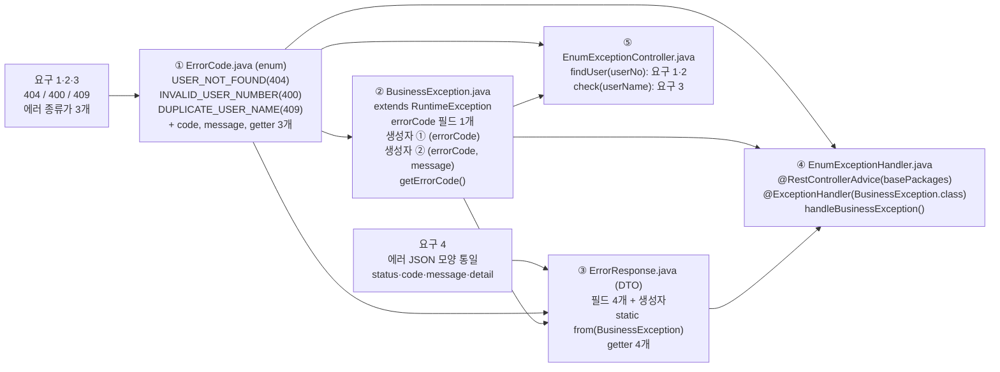

| 순서 | 파일 | 시나리오에서의 역할 | 먼저 있어야 하는 것 |
|---|---|---|---|
| ① | `ErrorCode.java` | 에러 **목록표**. 종류·상태 코드·코드 문자열·기본 메시지를 한 줄씩 | 없음 |
| ② | `BusinessException.java` | 목록표의 한 줄을 **들고 날아가는 봉투**. 상세 메시지를 덧붙일 수도 있음 | ① |
| ③ | `ErrorResponse.java` | 프론트가 요구한 **JSON 모양**. `from()`이 봉투를 열어 네 칸을 채움 | ①, ② |
| ④ | `EnumExceptionHandler.java` | 봉투를 **받아서** 상태 코드 + JSON으로 바꾸는 단 한 곳 | ①, ②, ③ |
| ⑤ | `EnumExceptionController.java` | 조건에 걸리면 봉투를 **던지기만** 함. 에러 JSON은 모름 | ①, ② (결과 확인은 ④까지) |

### 2. 실행 흐름 — 시나리오 1번 요청 `GET /enum-error/users/5`

#### 2-1. `findUser()` 경로 — `GET /enum-error/users/5`

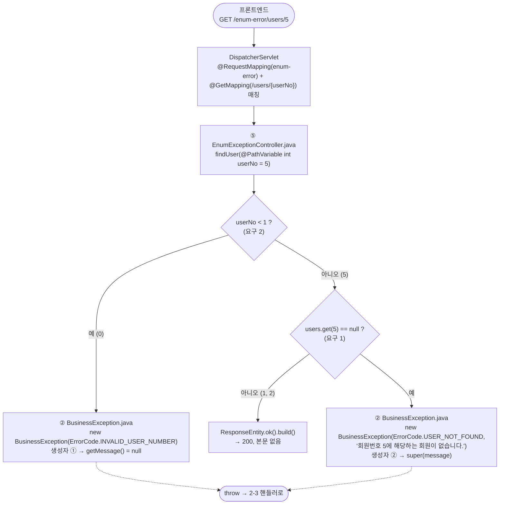

#### 2-2. `check()` 경로 — `GET /enum-error/users/check-name?userName=홍길동`

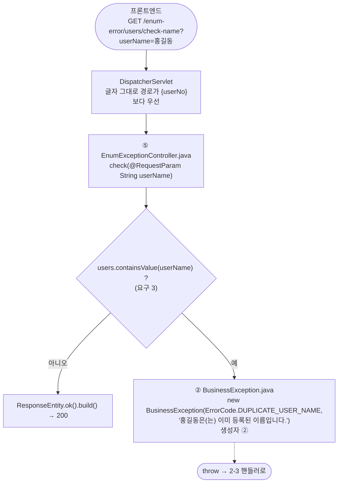

#### 2-3. 공통 — 핸들러가 예외를 JSON 응답으로 바꾸는 과정 (시나리오 1번 값으로)

```mermaid
flowchart TD
    IN(["2-1 / 2-2 에서 throw<br/>findUser()/check() 즉시 종료, DispatcherServlet 이 예외를 받음"]) -.-> H["④ EnumExceptionHandler.java<br/>@ExceptionHandler(BusinessException.class)<br/>handleBusinessException(businessException)"]
    H --> H1["② BusinessException.java<br/>getErrorCode() → ErrorCode.USER_NOT_FOUND"]
    H1 --> H2["③ ErrorResponse.java<br/>static from(businessException)"]
    H2 --> H3["① ErrorCode.java<br/>getHttpStatus().value() → 404<br/>getCode() → 'USER_NOT_FOUND'<br/>getMessage() → '회원을 찾을 수 없습니다.'"]
    H3 --> H4["② BusinessException.java<br/>getMessage() → '회원번호 5에 해당하는 회원이 없습니다.'"]
    H4 --> H5["③ ErrorResponse.java<br/>new ErrorResponse(404, 'USER_NOT_FOUND',<br/>'회원을 찾을 수 없습니다.', '회원번호 5에 …')"]
    H5 --> R["④ EnumExceptionHandler.java<br/>ResponseEntity.status(errorCode.getHttpStatus())  ← 404<br/>.body(response)"]
    R --> Z([프론트엔드<br/>404 + JSON<br/>status · code · message · detail<br/>(요구 4)])
```

### 3. 단계별 설명 (시나리오 1번: 5번 회원 조회)

1. **프론트가 `GET /enum-error/users/5`를 보낸다.** `DispatcherServlet`이 `@RequestMapping("enum-error")` + `@GetMapping("/users/{userNo}")`를 찾아 `EnumExceptionController.findUser()`에 `userNo = 5`를 넘긴다.

2. **`findUser()` 첫 검사(요구 2)**: `userNo < 1`? 5라서 통과.

3. **`findUser()` 둘째 검사(요구 1)**: `users.get(5)`는 `Map`에 없으니 `null`. 여기서 `ErrorCode.USER_NOT_FOUND`와 상세 메시지 `"회원번호 5에 해당하는 회원이 없습니다."`를 넣어 **생성자 ②**로 `BusinessException`을 만들고 `throw`한다.

4. **`BusinessException` 안에는** enum 상수(어떤 에러인지)와 `super(message)`로 저장된 상세 메시지가 들어 있다. `RuntimeException`이므로 `throws` 선언 없이 올라간다. **`throw` 된 순간 `findUser()`는 끝난다.** 32행 `return`은 실행되지 않는다. 컨트롤러는 에러 JSON이 어떻게 생겼는지 전혀 모른다.

5. **`DispatcherServlet`이 예외를 받는다.** `basePackages`가 `...section03.exceptionenum`으로 맞는 `@RestControllerAdvice`(`EnumExceptionHandler`) 안에서 `@ExceptionHandler(BusinessException.class)`가 붙은 `handleBusinessException()`을 찾아 예외 객체를 넘긴다. 컨트롤러와 핸들러 사이에 직접 호출은 없다. 이 파일이 없었던 것이 시나리오의 "500이 떠요"의 원인이다.

6. **`handleBusinessException()`은 두 가지를 한다.**
   - `businessException.getErrorCode()`로 enum 상수를 꺼내 → `ResponseEntity.status(errorCode.getHttpStatus())` = **404**.
   - `ErrorResponse.from(businessException)`으로 → **본문 DTO**.

7. **`ErrorResponse.from()`(정적 팩토리 메서드)** 이 봉투를 연다. enum에서 `getHttpStatus().value()`, `getCode()`, `getMessage()` 세 개, 예외에서 `getMessage()` 하나를 읽어 `new ErrorResponse(404, "USER_NOT_FOUND", "회원을 찾을 수 없습니다.", "회원번호 5에 …")`를 돌려준다. 호출하는 쪽은 `from()` 한 줄이면 된다.

8. **`@RestControllerAdvice` = `@ControllerAdvice` + `@ResponseBody`.** 반환한 `ResponseEntity<ErrorResponse>`가 JSON으로 직렬화된다. `ErrorResponse`의 getter 4개가 JSON 키 4개가 된다(요구 4). 프론트는 `code`로 분기하고 `detail`을 그대로 띄운다.

### 4. 시나리오별 결과 — 같은 길, 다른 enum 상수

| 시나리오 | 요청 | 걸리는 검사 | 생성자 | 응답 |
|---|---|---|---|---|
| 1 없는 회원 | `GET /enum-error/users/5` | `users.get(5) == null` | ② | `404`, `detail` 있음 |
| 2 잘못된 번호 | `GET /enum-error/users/0` | `userNo < 1` | ① | `400`, `detail: null` |
| 3 이름 중복 | `GET /enum-error/users/check-name?userName=홍길동` | `containsValue` | ② | `409`, `detail` 있음 |
| 정상 | `GET /enum-error/users/1` | 모두 통과 | — | `200`, 본문 없음 |

- 시나리오 2의 `detail`이 `null`인 이유: 생성자 ①은 `super(message)`를 부르지 않아 `getMessage()`가 `null`이다.
- 에러가 하나 늘어나면(예: 탈퇴 회원) 바뀌는 파일은 **①에 상수 한 줄, ⑤에 `if` 하나**뿐이다. ②③④는 그대로다. 이것이 enum + 공통 예외 + 핸들러로 나눈 이유다.

## 🧩 section05/swagger 리팩토링 — 클래스를 Impl로 바꾸고 인터페이스를 뽑아내기

### 0. 시나리오

> `SwaggerTestController` 한 클래스에 `@Tag`, `@Operation`, `@ApiResponses`, `@Parameter`를 붙이기 시작했더니
> 메서드 하나당 **문서 어노테이션 6~8줄 + 실제 코드 15줄**이 섞였다. 코드를 읽으려면 문서를 건너뛰어야 하고, 문서를 고치려면 코드 사이를 뒤져야 한다.

'나'의 결론: **"무엇을 제공하는가(문서)"와 "어떻게 처리하는가(코드)"를 파일로 나누자.** 이미 있는 클래스를 **구현체(Impl)** 로 돌리고, 그 위에서 **인터페이스를 뽑아낸다**. 새로 짜는 게 아니라 있는 코드를 옮기는 작업이다.

### 1. 실제로 한 순서 (IntelliJ 기준)

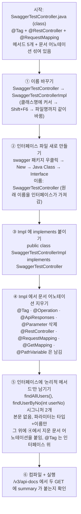

**단계별 설명**

1. **이름 바꾸기 (`SwaggerTestController` → `SwaggerTestControllerImpl`)**
   클래스 선언의 이름에 커서를 두고 `Shift+F6`(Refactor → Rename). IntelliJ가 파일명과 생성자 이름(`public SwaggerTestControllerImpl()`)까지 함께 바꾼다. 이 시점에는 아직 한 파일이고, 동작도 리팩토링 전과 같다.

2. **인터페이스 파일 만들기 (`SwaggerTestController`)**
   원래 클래스가 쓰던 이름을 **인터페이스가 물려받는다.** 바깥에서 부를 때는 "SwaggerTestController"라는 이름이 곧 API 명세가 되고, 뒤에 Impl이 붙은 쪽이 "그걸 실제로 하는 것"이 된다. Service 계층의 `UserService` / `UserServiceImpl`과 같은 작명 규칙이다.

3. **`implements` 연결**
   `public class SwaggerTestControllerImpl implements SwaggerTestController {`. 아직 인터페이스가 비어 있으므로 바로 컴파일된다.

4. **Impl 에서 문서 어노테이션 삭제**
   `@Tag`(클래스 위), `@Operation`·`@ApiResponses`·`@Parameter`(메서드 위)를 지운다. 지우는 기준은 **import 의 출처**: `io.swagger...`에서 온 것은 지우고, `org.springframework...`에서 온 것(`@RestController`, `@RequestMapping`, `@GetMapping`, `@PathVariable`, `@RequestBody`)은 남긴다. Spring 이 빈으로 등록하고 요청을 연결하는 대상은 **구현체**이기 때문이다. 인터페이스는 `new` 할 수 없다.

5. **인터페이스에는 "논리적 메서드"만**
   문서로 공개할 API, 즉 `findAllUsers()`와 `findUserByNo(int userNo)` 두 개의 **시그니처**만 적는다. 본문 `{ ... }`은 없고 `;`로 끝난다. 파라미터는 `@PathVariable int userNo` → `int userNo`로 **타입과 이름만** 남긴다. 그 위에 ④에서 지운 `@Operation`·`@ApiResponses`·`@Parameter`를 붙이고, `@Tag`는 인터페이스 선언 위에 둔다.
   `registUser`·`removeUser`·`modifyUser` 세 개는 인터페이스에 올리지 않았다. 올리지 않아도 Impl 의 `@PostMapping` 등은 그대로 동작한다. 인터페이스에 없는 메서드는 **문서에서 summary 없이** 나올 뿐이다.

6. **컴파일·실행 확인**
   인터페이스의 메서드 2개는 Impl 에 같은 이름·파라미터 타입으로 있어야 한다. 하나라도 어긋나면 `SwaggerTestControllerImpl is not abstract and does not override abstract method ...` 에러가 난다. 이 에러가 곧 **명세와 구현이 어긋났다는 검사**다.

### 2. 결과 — 무엇이 어디에 있나 (현재 코드 기준)

| | `SwaggerTestController` (interface) | `SwaggerTestControllerImpl` (class) |
|---|---|---|
| 역할 | API **명세**. "이런 API가 있고 이런 응답을 준다" | API **처리**. 요청을 받아 실제로 동작 |
| 클래스 어노테이션 | `@Tag` | `@RestController`, `@RequestMapping("/swagger")` |
| 메서드 | `findAllUsers()`, `findUserByNo(int)` 시그니처 2개 | 5개 전부 (`findAllUsers`, `findUserByNo`, `registUser`, `removeUser`, `modifyUser`) |
| 메서드 어노테이션 | `@Operation`, `@ApiResponses`/`@ApiResponse`, `@Parameter` | `@GetMapping`/`@PostMapping`/`@PutMapping`/`@DeleteMapping` |
| 파라미터 어노테이션 | 없음 | `@PathVariable`, `@RequestBody` |
| 본문 | 없음 | 전부 |
| 필드·생성자 | 없음 | `users` 리스트, 기본 생성자 |

규칙 한 줄: **`io.swagger`로 시작하는 import 는 인터페이스에, `org.springframework`로 시작하는 import 는 구현체에.**

### 3. 실행 흐름 — 두 갈래

#### 3-1. 요청이 들어올 때 (Spring MVC): 인터페이스는 등장하지 않는다

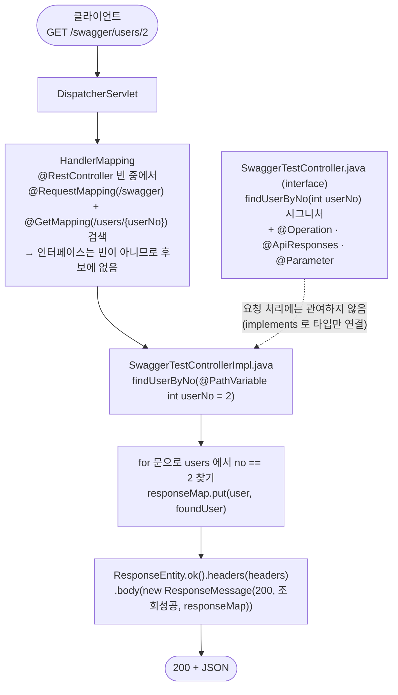

요청 처리는 **리팩토링 전과 완전히 같다.** `DispatcherServlet`은 `@RestController`가 붙은 **구현체 빈**만 찾는다.

#### 3-2. 문서를 만들 때 (springdoc): Impl 에서 출발해 인터페이스로 올라간다

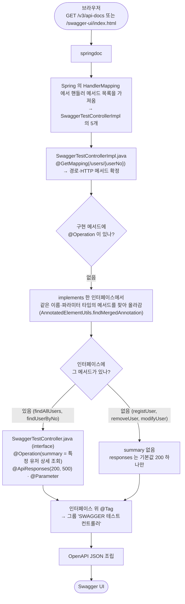

**경로와 HTTP 메서드**는 Impl 의 `@GetMapping`에서, **설명·응답 코드·그룹 이름**은 인터페이스의 어노테이션에서 온다. springdoc 이 인터페이스까지 올라가 읽는 이유는 Spring 의 `AnnotatedElementUtils.findMergedAnnotation()`이 메서드에 어노테이션이 없으면 **부모 클래스와 인터페이스의 같은 메서드**까지 탐색하기 때문이다. `implements` 관계가 곧 탐색 경로다.

실행해서 확인한 `/v3/api-docs` 결과:

| Method | Path | summary | responses | 비고 |
|---|---|---|---|---|
| GET | `/swagger/users` | 모든 사용자 조회 | 200, 500 | 인터페이스에 있음 |
| GET | `/swagger/users/{userNo}` | 특정 유저 상세 조회 | 200, 500 | 인터페이스에 있음 |
| POST | `/swagger/users` | (없음) | 200 | 인터페이스에 없음 |
| DELETE | `/swagger/users/{userNo}` | (없음) | 200 | 인터페이스에 없음 |
| PUT | `/swagger/user/{userNo}` | (없음) | 200 | 인터페이스에 없음 |

다섯 개 모두 `@Tag` 덕에 같은 그룹 'SWAGGER 테스트 컨트롤러' 아래에 묶인다. summary 가 붙은 두 개와 안 붙은 세 개의 차이가 **"인터페이스에 올렸는가"** 하나다. 나머지 셋도 문서화하려면 인터페이스에 시그니처를 추가하고 `@Operation`을 붙이면 된다.

### 4. 전·후 비교 — `findAllUsers`

**전 (한 파일, 클래스)**
```java
@Tag(name = "SWAGGER 테스트 컨트롤러", description = "Section #5의 스웨거 테스트입니다.")
@RestController
@RequestMapping("/swagger")
public class SwaggerTestController {

    @Operation(summary = "모든 사용자 조회", description = "모든 사용자를 조회합니다.")
    @ApiResponses(value = {
            @ApiResponse(responseCode = "200", description = "조회 성공"),
            @ApiResponse(responseCode = "500", description = "조회 실패")
    })
    @GetMapping("/users")
    public ResponseEntity<ResponseMessage> findAllUsers() {
        // ... 15줄
    }
}
```

**후 (두 파일)**
```java
// SwaggerTestController.java — 명세 (interface)
@Tag(name = "SWAGGER 테스트 컨트롤러", description = "Section #5의 스웨거 테스트입니다.")
public interface SwaggerTestController {

    @Operation(summary = "모든 사용자 조회", description = "모든 사용자를 조회합니다.")
    @ApiResponses(value = {
            @ApiResponse(responseCode = "200", description = "조회 성공", content = @Content(schema = @Schema(implementation = ResponseMessage.class))),
            @ApiResponse(responseCode = "500", description = "조회 실패", content = @Content(schema = @Schema(hidden = true)))
    })
    public ResponseEntity<ResponseMessage> findAllUsers();
}

// SwaggerTestControllerImpl.java — 처리 (class)
@RestController
@RequestMapping("/swagger")
public class SwaggerTestControllerImpl implements SwaggerTestController {

    @GetMapping("/users")
    public ResponseEntity<ResponseMessage> findAllUsers() {
        // ... 15줄 그대로
    }
}
```

### 5. 주의할 점 · 정리하면 좋은 것

- **`@Override`를 붙이는 습관.** 지금 Impl 에는 없다. 없어도 컴파일되지만, 붙여 두면 이름을 잘못 쳤을 때 "인터페이스를 구현하지 않았다"가 아니라 "`@Override` 할 메서드가 없다"는 더 정확한 에러를 그 줄에서 바로 받는다. 메서드명에 커서 → `Option+Enter` → Add `@Override`.
- **인터페이스 메서드의 `public`은 생략 가능.** 인터페이스 메서드는 자동으로 `public abstract`다. 적어도 틀리진 않지만 IntelliJ가 회색으로 "불필요"라고 표시한다. 구현체 쪽은 반드시 `public`이어야 한다(접근 범위를 좁힐 수 없음).
- **남은 import 정리.** 두 파일 모두 옮기고 난 뒤의 import 가 그대로 남아 있다(인터페이스에 `HttpHeaders`·`GetMapping`, Impl 에 `io.swagger...`). 동작에는 영향 없지만 `Ctrl+Option+O`(Optimize Imports)로 한 번에 지울 수 있다. 지우고 나면 "`io.swagger`는 인터페이스, `org.springframework`는 Impl"이라는 규칙이 import 목록에서 눈에 보인다.
- `@Schema(implementation = ResponseMessage.class)`는 "200일 때 본문이 이 클래스 모양", `@Schema(hidden = true)`는 "500일 때 본문 스키마는 표시 안 함". 둘 다 문서 표시용이고 실행에는 영향이 없다.
- `@PathVariable`·`@RequestBody`는 Impl 에 둔다. Spring 5.1부터 인터페이스 쪽 파라미터 어노테이션도 상속되긴 하지만, "Spring 것은 Impl, Swagger 것은 인터페이스" 규칙을 지키는 편이 읽기 쉽다.
- 같은 구조가 **Service 계층**에서 그대로 반복된다: `UserService`(interface) + `UserServiceImpl`(class). 컨트롤러에서 한 번 손으로 해 봤으니 다음 챕터에서 같은 그림이 나온다.

### 6. 함께 고친 것 (오타만)

- 인터페이스 `@Operation(summary = "특정 유저 상세 조쇠")` → `"특정 유저 상세 조회"`
- Impl 주석 `applicadtion/json` → `application/json` (2곳), `마직 회원` → `마지막 회원`

고치지 않고 남겨 둔 것(로직이라 판단은 본인 몫): `registUser()`의 `Location` 이 `/entity/users/…`로 section02 를 가리킴(이 컨트롤러면 `/swagger/users/…`가 맞음), `modifyUser()` 경로가 `user/{userNo}` 단수(다른 메서드는 `users`).


# JPA
- ORM은 매핑기술이라고 보면 됨
- ORM framework 를 데이터베이스와의 객체지향 관점을 유지
- Mybatis / JPA 
- JPA는 테이블 데이터 자체를 객체로 변경 > query를 짤 필요 없음
- 객체지향과 관계지향이라는 서로 다른 패러다임 불일치를 해소
- JPA의 단점: 진입장벽이 높다
Mybatis: SQL Mapper라고 함


JPA는 Java 애플리케이션과 데이터베이스 사이에 위치한 추상화 계층이다. 
추상화: 복잡한 부분은 숨기고 필요한 부분만 사용하게

- 영속성 컨텍스트: JPA의 핵심(persistence context)

- Spring에서는 Spring Data JPA라고 함


Spring Data JPA > Repository Interface를 기반으로 구현할 것임

(의존성 주입)


- 예습과제
영속성 컨텍스트가 뭔지?
엔티티가 뭔지?
둘이 무슨 관계인지?


공통
## 🗂️ chap00-jpa-intro — 3단계로 보는 "SQL 없이 tbl_menu 다루기"

> 1단계는 큰 그림, 2단계는 파일별 흐름, 3단계는 JPA 가 내부에서 하는 일. 각 단계는 **설명 → 다이어그램 → 실행 예시** 순서.
> 실행 예시의 응답과 SQL 은 2026-11-04 에 8081 포트로 직접 실행해서 얻은 것. "손으로 추적" 이라고 적은 것만 실행하지 않았다.

---

### 1단계 (개괄) — JPA 가 끼어들면 무엇이 달라지나

#### 설명

JDBC 때는 `SELECT * FROM tbl_menu` 를 **내가 문자열로 쓰고**, `ResultSet` 을 한 줄씩 꺼내 `Menu` 객체에 옮겨 담았다.
JPA 에서는 그 두 일을 모두 Hibernate 가 한다. 내가 하는 일은 세 가지뿐이다.

1. **엔티티** : "이 클래스는 `tbl_menu` 테이블 한 행이다" 라고 어노테이션으로 알려 준다 (`Menu.java`).
2. **리포지토리** : `JpaRepository<Menu, Integer>` 를 상속한 **빈 인터페이스**를 만든다 (`MenuRepository.java`). 구현 클래스는 Spring Data JPA 가 실행 시점에 만들어 준다.
3. **서비스에서 메서드 호출** : `findAll()`, `findById()`, `save()` 를 부르면 Hibernate 가 SQL 을 만들어 MySQL 에 보내고, 결과를 `Menu` 객체로 돌려준다.

Controller → Service → Repository 라는 3층 구조는 MVC 때와 같다. 바뀐 것은 **맨 아래층이 JDBC 코드에서 "인터페이스 + JPA" 로 교체된 것**이다.

#### 다이어그램

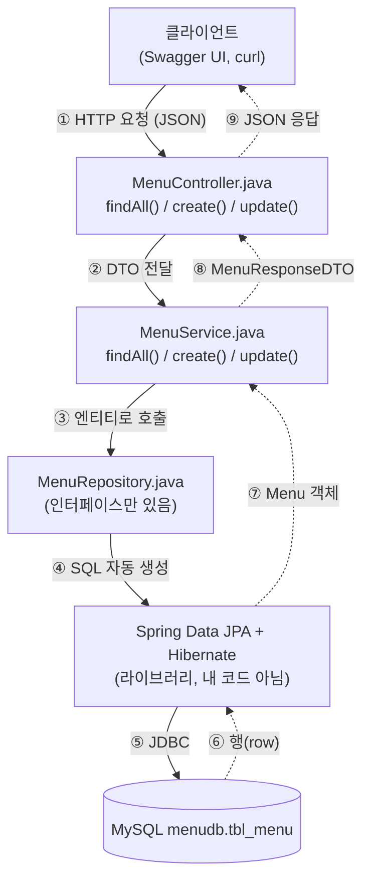

- 실선은 요청이 내려가는 길, 점선은 결과가 올라오는 길.
- ④~⑦ 구간에는 **내가 쓴 코드가 한 줄도 없다.** 콘솔에 찍히는 SQL 은 전부 Hibernate 가 만든 것이다.

#### 실행 예시

Swagger UI (`http://localhost:8080/swagger-ui/index.html`) 에서 `GET /api/menus` → **Execute**, 또는 터미널에서:

```bash
curl http://localhost:8080/api/menus
```

응답 (41건 중 앞 2건):

```json
[
  {"menuCode":1,"menuName":"열무김치라떼","menuPrice":4500,"categoryCode":8,"orderableStatus":"Y"},
  {"menuCode":2,"menuName":"우럭스무디","menuPrice":5000,"categoryCode":10,"orderableStatus":"Y"}
]
```

같은 순간 IntelliJ 콘솔 (yaml 의 `org.hibernate.SQL: debug` 덕분에 보인다):

```sql
select
    m1_0.menu_code,
    m1_0.category_code,
    m1_0.menu_name,
    m1_0.menu_price,
    m1_0.orderable_status
from
    tbl_menu m1_0
```

`m1_0` 같은 별칭, 컬럼 순서, `from` 절 모두 내가 쓴 적이 없다. **엔티티의 `@Column` 이름을 읽어서 만든 SQL** 이다.

---

### 2단계 (파일별 흐름) — 요청 하나가 어느 파일의 어느 메서드를 지나가나

#### 설명

파일은 역할 순서대로 다섯 개다. 작성한 순서도 이 순서였다.

| 순서 | 파일 | 역할 | 핵심 코드 |
|---|---|---|---|
| 1 | `entity/Menu.java` | 테이블 한 행 = 객체 하나 | `@Entity @Table(name="tbl_menu")`, `@Id @GeneratedValue(IDENTITY)`, `@Column(name=...)` |
| 2 | `repository/MenuRepository.java` | DB 접근 메서드 묶음 | `interface MenuRepository extends JpaRepository<Menu, Integer>` 끝 |
| 3 | `dto/MenuRequestDTO.java`, `dto/MenuResponseDTO.java` | 바깥(JSON)과 안(엔티티) 사이의 운반용 객체 | `MenuResponseDTO.from(Menu)` 정적 팩토리 |
| 4 | `service/MenuService.java` | 비즈니스 로직 + **트랜잭션 경계** | `@Transactional`, `menuRepository.findAll() / save() / findById()` |
| 5 | `controller/MenuController.java` | URL ↔ 메서드 매핑, JSON 변환 | `@RestController`, `@GetMapping / @PostMapping / @PutMapping` |

왜 DTO 가 둘인가:
- **MenuRequestDTO** 에는 `menuCode` 가 없다. 등록할 때 번호는 DB 가 `auto_increment` 로 정하므로 클라이언트가 보낼 수 없다.
- **MenuResponseDTO** 에는 `menuCode` 가 있다. 저장 후 DB 가 정한 번호를 돌려줘야 한다.
- 엔티티를 그대로 JSON 으로 내보내지 않는 이유 : 엔티티는 DB 구조에 묶여 있고, 나중에 연관관계(카테고리 등)가 붙으면 JSON 이 무한히 커질 수 있다. 바깥에 보여 줄 모양은 DTO 가 정한다.

왜 `Menu` 에 setter 가 없고 `change()` 만 있나:
- setter 넷을 열어 두면 아무 곳에서나 한 필드씩 바꿀 수 있어 "반쯤 수정된" 엔티티가 생긴다.
- `change(이름, 가격, 카테고리, 상태)` 하나로 묶어 두면 **수정은 항상 네 값이 함께** 바뀐다. 생성자도 같은 메서드를 재사용한다.
- `@NoArgsConstructor(access = PROTECTED)` : JPA 가 DB 행을 객체로 되살릴 때 빈 생성자가 필요하지만, 내 코드에서 `new Menu()` 로 빈 객체를 만드는 것은 막는다.

#### 다이어그램

세 요청이 지나가는 파일과 메서드. 요청마다 차트를 따로 두었다.

**① GET /api/menus — 전체 조회**

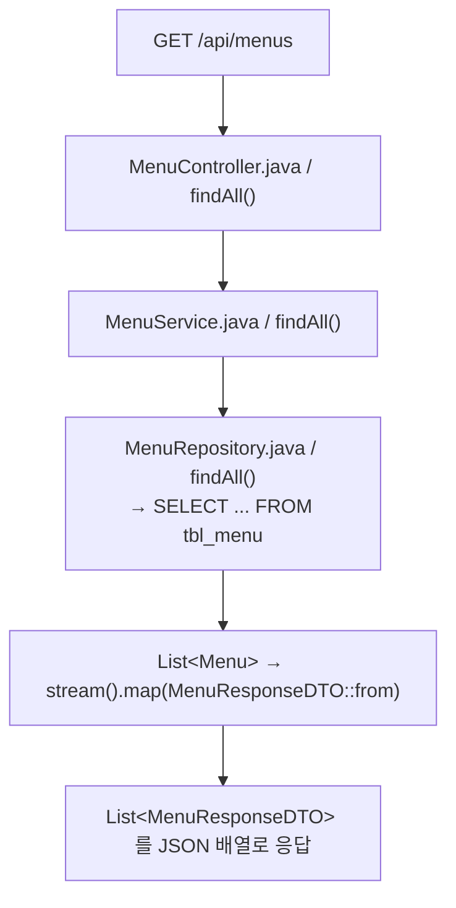

**② POST /api/menus — 등록**

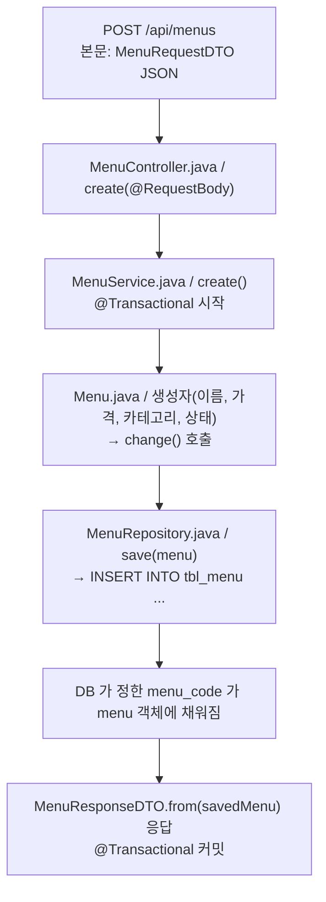

**③ PUT /api/menus/{menuCode} — 수정**

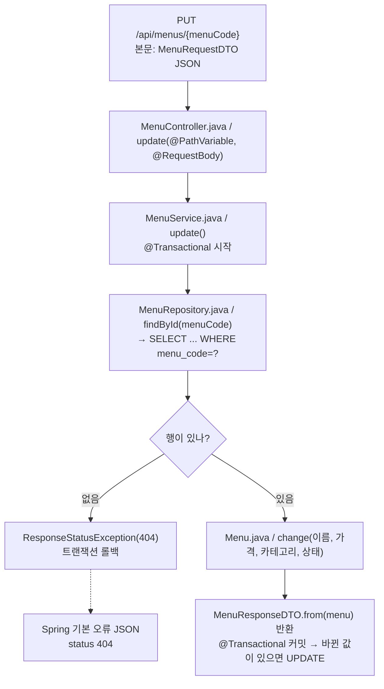

단계별 설명 (PUT 기준):

1. `MenuController.update()` : URL 의 `{menuCode}` 는 `@PathVariable` 로, 본문 JSON 은 `@RequestBody` 로 `MenuRequestDTO` 에 담긴다.
2. `MenuService.update()` 에 `@Transactional` 이 붙어 있으므로 **여기서 트랜잭션이 열린다.**
3. `findById(menuCode)` 가 `SELECT ... WHERE menu_code=?` 를 보낸다. 결과는 `Optional<Menu>`.
4. `orElseThrow()` : 비어 있으면 404 예외를 던지고 트랜잭션은 롤백된다.
5. 찾았으면 `menu.change(...)` 로 네 필드를 바꾼다. **`save()` 를 부르지 않는다.**
6. 메서드가 끝나면 트랜잭션이 커밋되고, 그 순간 Hibernate 가 바뀐 필드가 있는지 비교해 `UPDATE` 를 보낸다 (3단계에서 자세히).
7. 응답은 `MenuResponseDTO.from(menu)`.

#### 실행 예시

**POST** (Swagger 의 `POST /api/menus` → Try it out, 또는 아래). 실제로 행이 추가되므로 이 노트를 쓰면서는 실행하지 않았다 (손으로 추적).

```bash
curl -X POST http://localhost:8080/api/menus \
  -H 'Content-Type: application/json' \
  -d '{"menuName":"테스트메뉴","menuPrice":1000,"categoryCode":1,"orderableStatus":"Y"}'
```

기대 응답 : 보낸 네 값 + DB 가 정한 `menuCode`.
콘솔에는 `insert into tbl_menu (category_code, menu_name, menu_price, orderable_status) values (?, ?, ?, ?)` 가 찍힌다. `menu_code` 가 컬럼 목록에 **없다**. `IDENTITY` 전략이라 DB 에 맡기기 때문이다.

**PUT, 존재하는 번호** (실행함. 1번 메뉴에 현재 값 그대로 보냈으므로 DB 는 안 바뀜):

```bash
curl -X PUT http://localhost:8080/api/menus/1 \
  -H 'Content-Type: application/json' \
  -d '{"menuName":"열무김치라떼","menuPrice":4500,"categoryCode":8,"orderableStatus":"Y"}'
```

```json
{"menuCode":1,"menuName":"열무김치라떼","menuPrice":4500,"categoryCode":8,"orderableStatus":"Y"}
```

**PUT, 없는 번호** (실행함):

```bash
curl -X PUT http://localhost:8080/api/menus/99999 -H 'Content-Type: application/json' \
  -d '{"menuName":"x","menuPrice":1,"categoryCode":1,"orderableStatus":"N"}'
```

```json
{"timestamp":"2026-11-04T07:59:50.971Z","status":404,"error":"Not Found","path":"/api/menus/99999"}
```

두 PUT 모두 콘솔에는 같은 `select ... where m1_0.menu_code=?` 가 먼저 찍혔고, `binding parameter (1:INTEGER) <- [1]` / `<- [99999]` 로 바인딩 값이 보였다 (yaml 의 `org.hibernate.orm.jdbc.bind: trace`).

---

### 3단계 (내부 동작) — `update()` 에 `save()` 가 없는데 왜 UPDATE 가 나가나

#### 설명

핵심 단어는 **영속성 컨텍스트(persistence context)** 와 **변경 감지(dirty checking)** 다. 예습과제의 세 질문이 바로 이것이다.

- **엔티티** : `@Entity` 가 붙은 클래스의 객체. `Menu` 하나가 `tbl_menu` 한 행이다.
- **영속성 컨텍스트** : 트랜잭션 동안 JPA 가 들고 있는 "엔티티 보관함". `findById()` 로 꺼낸 `Menu` 는 여기에 **등록(영속 상태)** 되고, 등록 당시의 값을 **스냅샷**으로 따로 복사해 둔다.
- **둘의 관계** : 트랜잭션이 커밋되는 순간 JPA 는 보관함의 모든 엔티티를 스냅샷과 비교한다. 달라진 필드가 있으면 그 엔티티에 대해 `UPDATE` 를 만들어 보낸다 (flush). 같으면 아무 SQL 도 보내지 않는다.

그래서 세 메서드가 다르게 생겼다.

| 메서드 | `@Transactional` | `save()` | 이유 |
|---|---|---|---|
| `findAll()` | 없음 | 없음 | 읽기만 한다. 비교할 변경이 없다 |
| `create()` | 있음 | **있음** | `new Menu(...)` 는 보관함 밖에서 태어난 객체다. `save()` 로 넣어 줘야 JPA 가 안다 |
| `update()` | 있음 | **없음** | `findById()` 가 이미 보관함에 넣었다. 값만 바꾸면 커밋 때 알아서 비교한다 |

주의할 점 세 가지:

1. `@Transactional` 을 `update()` 에서 빼면 보관함이 메서드 끝에 닫히지 않고 **아예 열리지 않아서** `change()` 를 해도 UPDATE 가 나가지 않는다. 값은 메모리에서만 바뀐다.
2. `IDENTITY` 전략에서는 `INSERT` 만 예외적으로 **`save()` 호출 즉시** 나간다. 번호를 DB 가 정하니 번호를 알려면 바로 넣어야 하기 때문이다. `UPDATE` 는 커밋 때 나간다.
3. `ddl-auto: none` 이므로 엔티티와 테이블이 안 맞아도 테이블을 건드리지 않는다. 대신 실행 중 SQL 오류로 드러난다. `@Column(name=...)` 을 테이블 컬럼명과 정확히 맞추는 이유다.

#### 다이어그램

`MenuService.update()` 한 번 동안 영속성 컨텍스트에서 일어나는 일.

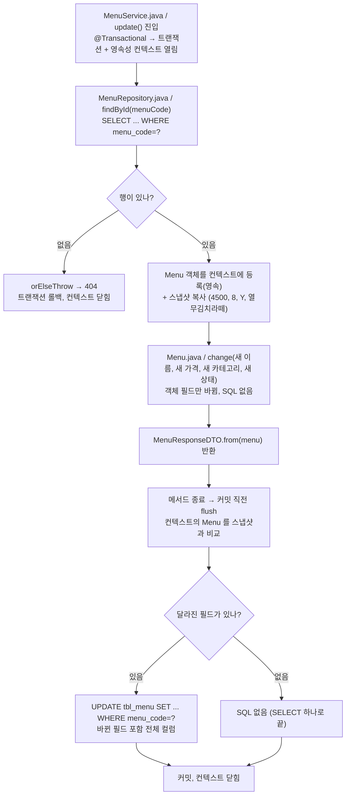

`create()` 는 이 그림과 다르다 : `new Menu(...)` → `save()` 에서 **곧바로 INSERT** → 반환된 객체가 그때 컨텍스트에 등록 → 커밋.

#### 실행 예시

**값을 안 바꾼 PUT** (실행함. 위 2단계와 같은 요청):

콘솔에 찍힌 SQL 은 `select ... where m1_0.menu_code=?` **하나뿐**이고 `update` 는 없었다. 스냅샷과 비교해 달라진 필드가 0 개였기 때문이다. `update()` 메서드가 돌긴 했지만 DB 입장에서는 읽기만 한 셈이다.

**값을 바꾼 PUT** (손으로 추적. 실제 행이 바뀌므로 실행하지 않았다. Swagger 에서 직접 해 보면 콘솔에서 확인할 수 있다):

```bash
curl -X PUT http://localhost:8080/api/menus/1 \
  -H 'Content-Type: application/json' \
  -d '{"menuName":"열무김치라떼","menuPrice":4700,"categoryCode":8,"orderableStatus":"Y"}'
```

기대하는 콘솔 순서:

```sql
select ... from tbl_menu m1_0 where m1_0.menu_code=?      -- findById, 바인딩 [1]
update tbl_menu
set category_code=?, menu_name=?, menu_price=?, orderable_status=?
where menu_code=?                                           -- 커밋 직전 flush, 바인딩 [8, 열무김치라떼, 4700, Y, 1]
```

가격 하나만 바꿨는데 `set` 에 네 컬럼이 다 들어간다. Hibernate 기본값은 "바뀐 엔티티의 **모든 컬럼**을 다시 쓴다" 이다. (컬럼만 골라 쓰게 하는 `@DynamicUpdate` 는 다음 기회에.)

**확인 질문 (예습과제 답으로 써 보기)**
- `update()` 에서 `menuRepository.save(menu)` 를 한 줄 추가하면 결과가 달라질까? → 달라지지 않는다. 이미 영속 상태인 객체를 `save()` 하면 JPA 는 "아는 객체네" 하고 그냥 지나간다 (merge 가 되지만 변경 사항은 동일). 없어도 되는 줄이니 안 쓰는 것이 원래 의도를 드러낸다.
- `@Transactional` 을 지우고 `save(menu)` 를 넣으면? → 이때는 `save()` 자체가 짧은 트랜잭션을 열어 `UPDATE` 를 보낸다. 동작은 하지만 "조회와 수정이 한 트랜잭션" 이라는 보장이 사라진다.

## 📝 예습과제 3문제 — "엔티티 · 영속성 컨텍스트 · 둘의 관계" 를 3단계로

> 내가 적어 둔 질문 셋 : ① 영속성 컨텍스트가 뭔지? ② 엔티티가 뭔지? ③ 둘이 무슨 관계인지?
> 1단계는 한 줄 답 + 비유, 2단계는 chap00-jpa-intro 코드 안에서 둘이 어디에 있는지, 3단계는 엔티티의 상태 변화와 컨텍스트가 하는 네 가지 일.
> 실행 예시 중 "실행함" 은 2026-11-04 에 8081 포트로 돌린 결과, "손으로 추적" 은 돌리지 않은 것.

---

### 1단계 (개괄) — 세 질문에 한 줄씩

#### 설명

| 질문 | 한 줄 답 |
|---|---|
| ② 엔티티가 뭔지 | `@Entity` 가 붙은 클래스의 **객체 하나 = 테이블의 행 하나**. `Menu` 객체 하나가 `tbl_menu` 의 한 줄이다 |
| ① 영속성 컨텍스트가 뭔지 | 트랜잭션 동안 JPA 가 엔티티를 넣어 두고 **지켜보는 보관함**. DB 에서 꺼내 왔거나 `save()` 로 넣은 엔티티가 여기 산다 |
| ③ 둘의 관계 | 보관함 **안에 있는** 엔티티만 JPA 가 돌본다. 안에 있으면 값을 바꾸기만 해도 커밋 때 `UPDATE` 가 나가고, 밖에 있으면 아무리 바꿔도 DB 는 모른다 |

비유 : 도서관의 **대출 카운터**.
- 책 한 권 = 엔티티 (서가의 자리 하나 = 테이블의 행 하나).
- 카운터에 올려진 책 = 영속 상태. 사서가 "이 책 지금 어떤 상태인지" 적어 둔다 (스냅샷).
- 카운터에 올려진 책에 메모를 붙이면 반납(커밋) 때 사서가 알아채고 장부(DB)를 고친다.
- 집에서 산 책(`new Menu(...)`)은 카운터에 올리기(`save()`) 전까지 도서관이 모른다.
- 비유가 깨지는 곳 : 진짜 도서관은 책을 돌려받아야 장부를 고치지만, JPA 는 **메서드가 끝나는 순간** 알아서 비교한다. 돌려주는 동작(`save()`)이 필요 없다.

#### 다이어그램

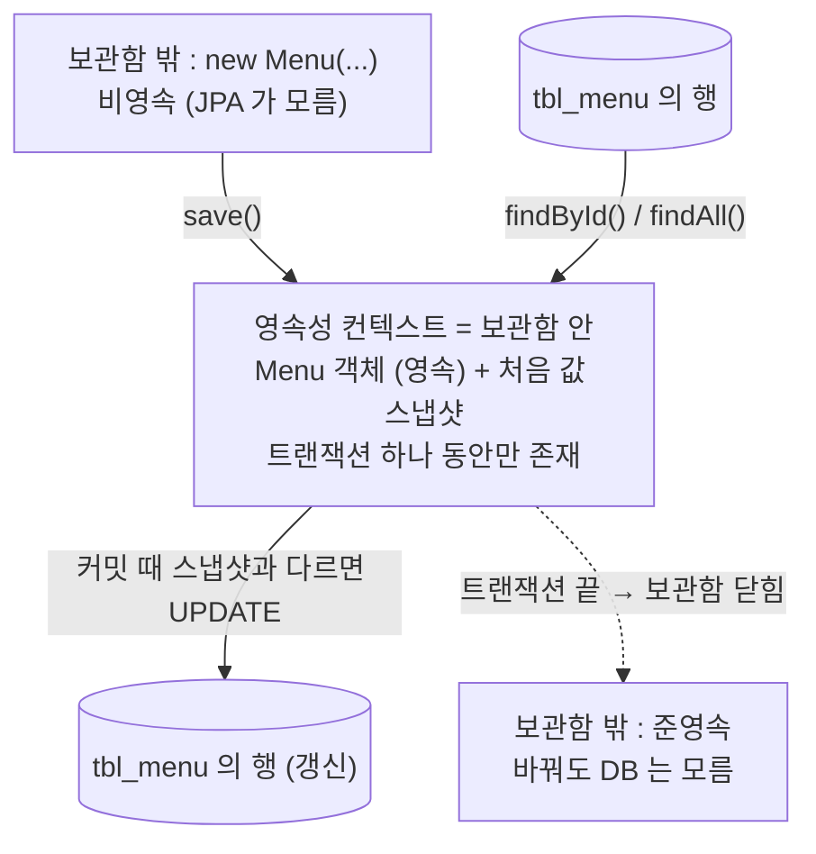

#### 실행 예시 (실행함)

`GET /api/menus` 한 번 = 보관함이 열리고, 41개의 `Menu` 가 들어왔다가, 메서드가 끝나며 보관함이 닫히는 과정이다.
콘솔에는 `select ... from tbl_menu m1_0` 하나만 찍힌다. 읽기만 했으니 41개 모두 스냅샷과 같고, `UPDATE` 는 0 개.

응답에 보이는 `{"menuCode":1,"menuName":"열무김치라떼", ...}` 는 **엔티티가 아니라** `MenuResponseDTO` 다. 엔티티는 보관함과 함께 닫혔고, 바깥으로는 복사본(DTO)만 나간다.

---

### 2단계 (코드 속 위치) — chap00-jpa-intro 어디에 엔티티가 있고, 어디서 보관함이 열리나

#### 설명

**② 엔티티는 `entity/Menu.java` 한 파일이다.** 어노테이션 하나하나가 "행 ↔ 객체" 대응표다.

| 어노테이션 | 뜻 | 없으면 |
|---|---|---|
| `@Entity` | 이 클래스는 JPA 가 관리하는 엔티티다 | JPA 가 클래스를 모른다. `findAll()` 의 반환형으로 쓸 수 없다 |
| `@Table(name = "tbl_menu")` | 어느 테이블인가 | 클래스 이름 `menu` 테이블을 찾다가 실패 |
| `@Id` | 행을 구분하는 식별자 필드 | 엔티티로 인정되지 않는다 (필수) |
| `@GeneratedValue(strategy = IDENTITY)` | 번호는 DB 의 auto_increment 가 정한다 | `save()` 전에 내가 번호를 넣어야 한다 |
| `@Column(name = "menu_code")` | 필드 ↔ 컬럼 이름 대응 | 필드명 `menuCode` → 컬럼 `menu_code` 로 자동 변환되긴 하지만, 명시하는 습관 |
| `@NoArgsConstructor(access = PROTECTED)` | JPA 가 DB 행으로 객체를 만들 때 쓰는 빈 생성자 | 없으면 JPA 가 객체를 못 만든다. `PROTECTED` 는 내 코드에서 `new Menu()` 를 막는 것 |

**① 영속성 컨텍스트는 파일이 아니라 "시간" 이다.** `MenuService.java` 의 메서드에 붙은 `@Transactional` 이 시작되는 순간 열리고, 메서드가 끝나는 순간 닫힌다. 코드에 `EntityManager` 라는 이름이 보이지 않는 이유는 `MenuRepository` (JpaRepository) 가 안에서 대신 쓰기 때문이다.

**③ 관계는 `MenuService.java` 의 메서드 세 개에 그대로 드러난다.**

| 메서드 | 보관함 | 엔티티가 보관함에 들어오는 순간 | 그래서 |
|---|---|---|---|
| `findAll()` | `@Transactional` 없음 → `findAll()` 호출 동안만 잠깐 | `findAll()` 결과 41개 | 돌아오자마자 닫힘. DTO 로 바꿔 내보냄 |
| `create()` | 있음 | `save(menu)` 가 넣어 줌 | `new Menu(...)` 만으로는 밖. `save()` 가 꼭 필요 |
| `update()` | 있음 | `findById()` 가 넣어 줌 | 이미 안에 있으니 `change()` 만 하면 됨. `save()` 불필요 |

#### 다이어그램

세 메서드에서 엔티티가 보관함에 들어오는 지점. 메서드마다 차트를 따로 두었고, 굵은 화살표가 "들어오는 순간".

**① `MenuService.java / findAll()` — 트랜잭션 없음**

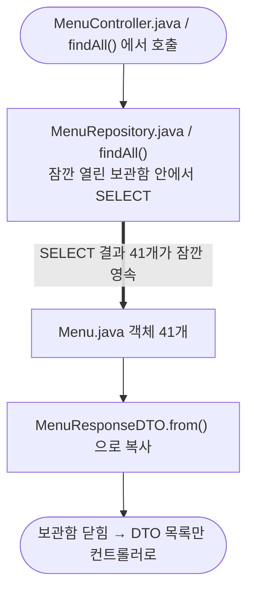

**② `MenuService.java / create()` — @Transactional**

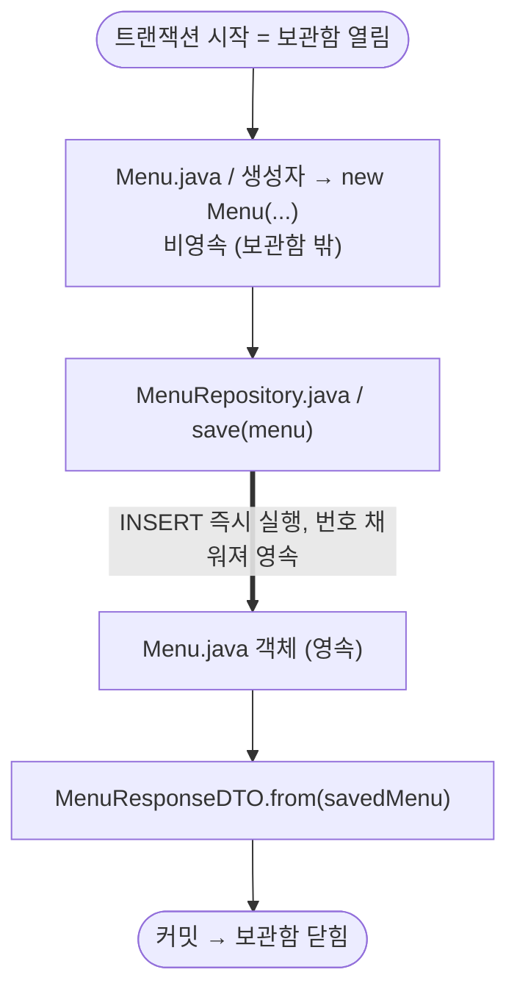

**③ `MenuService.java / update()` — @Transactional**

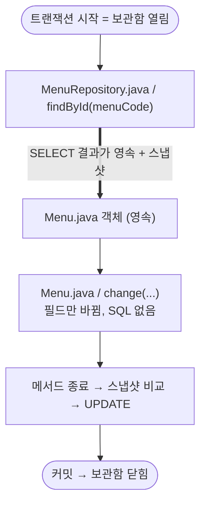

#### 실행 예시

**`update()` 에서 `save()` 없이 값이 저장되는 것** (2단계 jpa-intro 노트의 PUT 예시와 같은 요청, 실행함):

`PUT /api/menus/1` 에 현재 값을 그대로 보냈을 때 콘솔은 `select ... where m1_0.menu_code=?` 하나. 바뀐 값이 없으니 `UPDATE` 없음.
값을 바꿔 보내면 (손으로 추적) `select` 다음에 `update tbl_menu set ... where menu_code=?` 가 따라온다. 서비스 코드에 `save()` 가 한 줄도 없는데도 그렇다. 이것이 ③ 의 답이다 : **보관함 안의 엔티티는 바꾸기만 하면 된다.**

**`create()` 에서 `save()` 를 빼면** (손으로 추적) : 컴파일도 되고 200 응답도 오지만, `MenuResponseDTO.from(menu)` 의 `menuCode` 가 `null` 이고 콘솔에 `insert` 가 없다. `new Menu(...)` 는 보관함 밖이라 JPA 가 끝까지 모른다. 응답의 `menuCode: null` 이 "밖에 있었다" 는 증거다.

---

### 3단계 (내부 동작) — 엔티티의 네 가지 상태와 보관함이 하는 네 가지 일

#### 설명

**엔티티는 보관함과의 관계에 따라 네 상태를 오간다.**

| 상태 | 뜻 | chap00 코드에서 |
|---|---|---|
| 비영속 (new / transient) | 그냥 자바 객체. 보관함 밖 | `new Menu(...)` 직후 |
| 영속 (managed) | 보관함 안. 스냅샷이 있고 JPA 가 지켜본다 | `findById()` 결과, `save()` 반환값 |
| 준영속 (detached) | 한때 영속이었지만 보관함이 닫혀 떨어져 나옴 | `update()` 가 끝난 뒤의 `menu`. 이후 `change()` 해도 DB 는 모른다 |
| 삭제 (removed) | 커밋 때 `DELETE` 될 예정 | 오늘 코드에는 없음. `menuRepository.delete(menu)` 가 만드는 상태 |

**보관함(영속성 컨텍스트)이 영속 엔티티에 해 주는 네 가지 일.**

1. **1차 캐시** : 같은 트랜잭션 안에서 `findById(1)` 을 두 번 부르면 두 번째는 SQL 없이 보관함에서 꺼낸다. 그리고 두 결과는 **같은 객체**(`==` 가 true)다. 행 하나 = 객체 하나를 보관함이 보장한다.
2. **쓰기 지연** : `INSERT/UPDATE/DELETE` 를 바로 보내지 않고 모아 두었다가 커밋 직전(flush)에 한꺼번에 보낸다. 예외 : `IDENTITY` 전략의 `INSERT` 는 번호를 받아야 하므로 `save()` 즉시 나간다. 오늘 `create()` 가 그 경우다.
3. **변경 감지 (dirty checking)** : flush 때 영속 엔티티마다 스냅샷과 현재 값을 비교해 달라진 것만 `UPDATE`. `update()` 에 `save()` 가 없는 이유.
4. **지연 로딩** : 연관된 엔티티(예: 메뉴의 카테고리)를 실제로 쓸 때까지 SELECT 를 미룬다. 오늘 `Menu` 에는 연관관계가 없어 아직 안 나온다. 다음 챕터.

**순서가 중요하다** : flush 는 커밋 직전에 일어난다. `update()` 안에서 `change()` 뒤에 예외가 나면 flush 전에 롤백되므로 `UPDATE` 는 DB 에 닿지 않는다. "메서드가 끝까지 정상 종료해야 저장된다" 가 트랜잭션 경계의 뜻이다.

#### 다이어그램

엔티티 상태 변화. 노드는 상태, 화살표 라벨은 그 상태로 보내는 메서드.

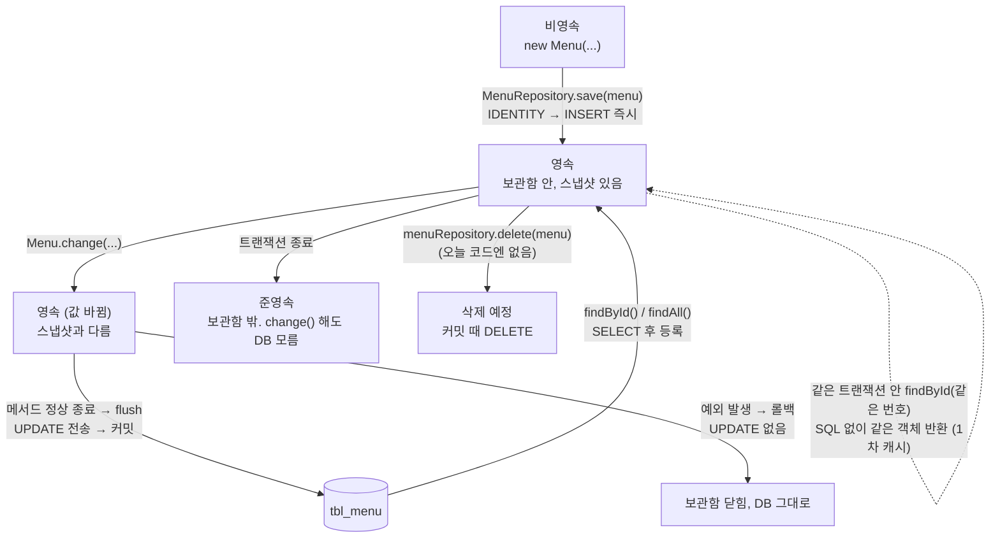

#### 실행 예시

**1차 캐시** (손으로 추적. 오늘 코드엔 같은 트랜잭션에서 두 번 조회하는 메서드가 없어 돌리지 않았다). `update()` 안에 아래 두 줄을 넣어 본다고 가정:

```java
Menu again = menuRepository.findById(menuCode).orElseThrow();
System.out.println(menu == again);   // true
```

콘솔 : `select ... where menu_code=?` 는 **한 번만** 찍히고, `true` 가 출력된다. 두 번째 `findById()` 는 DB 가 아니라 보관함에서 꺼냈고, 같은 객체를 돌려줬다. 트랜잭션 밖(`@Transactional` 을 지운 메서드)에서 같은 두 줄을 돌리면 select 가 두 번 찍히고 `false` 다 : 호출마다 보관함이 새로 열렸다 닫히기 때문이다.

**변경 감지 + 롤백** (손으로 추적):

```java
menu.change("바뀐이름", 9999, 8, "Y");
if (true) throw new RuntimeException("일부러");   // change() 뒤에 예외
```

`PUT` 응답은 500, 콘솔에는 `select` 만 있고 `update` 는 없다. 다시 `GET /api/menus/1` 하면 이름과 가격이 원래대로다. `change()` 는 메모리의 객체만 바꿨고, flush 가 오기 전에 트랜잭션이 롤백되어 DB 에는 아무것도 닿지 않았다.

**준영속** (손으로 추적) : `MenuController.update()` 에서 서비스가 돌려준 DTO 가 아니라 엔티티를 받았다고 치고, 컨트롤러에서 `menu.change(...)` 를 한 번 더 호출해도 `UPDATE` 는 나가지 않는다. 서비스 메서드가 끝난 순간 `menu` 는 준영속이 되어 아무도 지켜보지 않기 때문이다. **그래서 서비스가 DTO 를 돌려주고, 엔티티는 서비스 밖으로 내보내지 않는다.**

**세 질문의 최종 답 (한 문장)**
엔티티는 테이블 행을 나타내는 객체이고, 영속성 컨텍스트는 트랜잭션 동안 그 객체들을 등록해 두고 지켜보는 보관함이며, 보관함 안에 있는 동안만 JPA 가 엔티티의 변경을 감지해 SQL 로 옮긴다.
