# JPA

## 영속성 컨텍스트 (Persistence Context)
- 엔티티가 실제로 보관되는 곳은 엔티티 메니저가 아니라 엔티티 메니저를 생성할 때 함께 만들어지는 퍼시스턴스 컨텍스트
## 엔티티 매니저(Entity Manager)


**이미지 설명**
- 엔티티 매니저가 **만들어지는 순서**를 보여 주는 그림
- 그림 읽는 법: 상자 = 객체, 화살표 = 번호 순서대로 일어나는 일
  1. 설정 정보 조회: 빨간 상자로 강조한 `Persistence`가 `META-INF/persistence.xml`을 읽는다 (코드에서는 `Persistence.createEntityManagerFactory("jpatest")`의 `"jpatest"`가 그 안의 persistence-unit 이름)
  2. 생성: 읽은 설정으로 `EntityManagerFactory`(공장)를 만든다 → **1개만** 만들고 공유 (DB 연결 준비 때문에 비용이 큼)
  3. 생성: 공장이 `EntityManager`를 만든다 → 겹쳐 그린 타원 3개 = 필요할 때마다 **여러 개**
- 그림에 없는 것: 각 `EntityManager` 안에 영속성 컨텍스트가 하나씩 함께 생긴다는 점 (위 4번째 줄 메모의 내용)

## 엔티티의 생명 주기


**이미지 설명**
- **엔티티의 생명 주기**: 엔티티 객체가 어떤 상태를 오가는지, 어떤 메서드가 상태를 바꾸는지 보여 주는 그림
- 그림 읽는 법: 타원 = 엔티티의 상태, 화살표 위 글자 = 상태를 바꾸는 메서드
  - 가운데 큰 사각형 `Persistence Context` 안의 `Managed Entity` 3개 = **영속** (컨텍스트가 관리 중)
  - `New Entity` = **비영속**: `new`로 만들기만 한 객체 → `persist()`로 영속이 됨
  - `Detached Entity` = **준영속**: `detach()`(하나), `clear()`(전체), `close()`(매니저 종료)로 빠져나옴 → `merge()`로 다시 들어감
  - `Removed Entity` = **삭제**: `remove()`로 삭제 표시 → `persist()`로 되돌릴 수 있음
  - `DB` ↔ 컨텍스트: `find()` / JPQL 조회로 DB에서 읽어 오면 영속, `commit (flush)` 때 변경 내용이 DB로 감
  - 사각형 위의 둥근 `update` 화살표 = 영속 엔티티는 값만 바꿔도 컨텍스트가 알아서 처리 (아래 변경 감지)

### 2-3. 영속성 컨텍스트가 엔티티를 관리하는 원리


**이미지 설명**
- **Persistence Context 내부**: 1차 캐시와 쓰기 지연 SQL 저장소로 변경 감지가 일어나는 순서
- 그림 읽는 법
  - 아래쪽 **1차 캐시** 표: 열 = `타입+식별자`(key) / `Entity`(지금 객체) / `Snapshot`(처음 상태의 복사본), 행 = `Menu#1`, `Menu#2`
  - 위쪽 **쓰기 지연 SQL 저장소**: 바로 보내지 않고 모아 둔 SQL (`UPDATE SQL`)
  - 번호 순서: 1. 엔티티 값 변경 → 2. flush 발생 → 3. Dirty Checking (Entity와 Snapshot 비교, 아래 초록 화살표) → 4. UPDATE SQL 생성 → 5. SQL 실행 → 6. commit
- 필기
  - "영속 — key value 데이터를 등록": 영속 상태가 되면 1차 캐시에 `Menu#1 → 객체`로 등록됨
  - "한번 조회한 내용은 또 조회 안 함!": 같은 식별자로 다시 `find()`하면 DB가 아니라 1차 캐시에서 꺼냄
  - "영속 상태인 엔티티의 값이 변경된다": `menu1` Entity 칸에 빗금 (값이 바뀐 상태)
  - Snapshot 칸에 "초기상태", 두 칸 사이에 "차이점": flush 때 이 둘을 비교한다는 표시


**이미지 설명**
- 어제 만든 `chap00-jpa-intro`의 `MenuService.update()`: 위 그림의 변경 감지가 실제 코드에서 일어나는 곳
- 필기
  - `menuRepository.findById(menuCode)`로 찾은 `menu` (빨간 상자) → "영속성 컨텍스트에서 관리": 조회하는 순간 영속 상태
  - 오른쪽 `Entity | SnapShot` 표의 ✓ 두 개: 조회할 때 엔티티와 스냅샷이 **둘 다** 저장됨
  - 화살표가 `menu.change(...)`로 이어짐: 값만 바꾸면 Entity 칸만 달라짐
- 그림에서 볼 점: `save()`나 `update()` 호출이 **없다**. `@Transactional` 메서드가 끝나며 commit → flush → 스냅샷과 비교 → UPDATE가 나감 (이 마지막 부분은 그림에 없음)

### Flush
- 커밋을 내보내는 행위(DB에 반영하는 행위)

### 변경 감지(Dirty Checking)


**이미지 설명**
- 강사님의 `A_EntityMangerLifeCycleTests.java`: 테스트 전후에 공장(EMF)과 매니저(EM)를 만들고 닫는 메서드 4개
- 빨간 숫자 = **실행 순서** (소스에 적힌 순서가 아님)
  1. ① `@BeforeAll` `initFactory()`: `Persistence.createEntityManagerFactory("jpatest")` → 공장 생성. 주석에 그때 하는 일: 메타 데이터 처리(엔티티 클래스 구조·관계 정보 저장), 커넥션 풀 초기화, 캐시 초기화(1차 캐시, 쿼리 캐시)
  2. ② `@BeforeEach` `initManager()`: 테스트 메서드가 **각각** 호출되기 전에 `createEntityManager()` → 엔티티 매니저 생성
  3. ③ 오른쪽 빨간 곡선 "Test코드": 이 사이에 `@Test` 메서드가 실행됨
  4. ④ `@AfterEach` `closeManager()`: 테스트 하나가 끝날 때마다 엔티티 매니저 종료
  5. ⑤ `@AfterAll` `closeFactory()`: 모든 테스트가 끝나면 엔티티 팩토리 종료
- 소스에서는 `closeFactory()`(⑤)가 `closeManager()`(④)보다 위에 있지만, 실행 순서는 **애너테이션**이 정한다
- 위쪽 탭: `persistence.xml`, `Practice.java`, `Menu.java`, `TestClass.java`가 같은 프로젝트에 열려 있음 (`persistence.xml`이 ①에서 읽는 설정 파일)

---

## 🗂️ chap01-persistence-context — 3단계로 보는 "EMF·EM 생명 주기 → EntityManager로 등록·조회"

> 프로젝트: `04_SpringBoot/04_JPA/chap01-persistence-context` (Spring 없이 **Hibernate + JUnit**만 쓰는 Gradle 프로젝트)
> - `section01/lifecycle` — `A_EntityManagerLifeCycleTests`: 공장(EMF)과 작업자(EM)를 만들고 닫기
> - `section02/crud` — `A_EntityManagerCRUDTest`: 작업자(EM)로 `tbl_menu`에 메뉴를 **등록**(`persist`)하고 **조회**(`find`)하기
>
> 1단계는 큰 그림, 2단계는 파일·메서드별 흐름, 3단계는 Hibernate가 내부에서 하는 일. 각 단계는 **설명 → 다이어그램 → 실행 예시** 순서.
> 실행하지 않았고 전부 **손으로 추적**했다. hashCode 숫자와 새 메뉴 번호(42)는 예시이고, 2번 메뉴 값(우럭스무디)은 어제(11-04) chap00을 실제 실행했을 때의 응답에서 가져왔다.

---

### 1단계 (개괄) — Spring Boot 없이 JPA를 직접 띄우고, EM으로 DB를 다룬다

#### 설명

어제 `chap00-jpa-intro`에서는 Spring Boot가 `application.yaml`을 읽고 EMF와 EM을 **알아서** 만들어 `MenuRepository` 뒤에 숨겨 줬다. 그래서 코드에 `EntityManager`가 한 번도 안 보였다.
오늘 `chap01`은 Spring을 빼고 **순수 JPA(Hibernate)**만 쓴다. 숨겨져 있던 일을 테스트 코드에서 직접 한다.

1. **설정** : `persistence.xml`에 DB 접속 정보와 엔티티 목록을 적는다 (Spring의 `application.yaml` 역할).
2. **공장** : `Persistence.createEntityManagerFactory("jpatest")`로 EMF를 **한 번** 만든다.
3. **작업자** : 테스트마다 `createEntityManager()`로 EM을 **새로** 만들고, 끝나면 닫는다. (section01)
4. **일 시키기** : EM에게 `persist()`(등록), `find()`(조회)를 시킨다. 데이터를 바꾸는 등록은 **트랜잭션을 직접** 열고 닫는다. (section02)

비유: chap00은 식당에서 주문만 하면 요리가 나오는 것(Spring이 주방을 운영), chap01은 직접 주방을 차리고(공장) 요리사를 부르고(작업자) 요리를 시키고(등록·조회) 문을 닫는 것까지 하는 것.

**어제(Spring Data JPA)와 오늘(순수 JPA) 비교**

| 하는 일 | chap00 (어제) | chap01 (오늘) |
| --- | --- | --- |
| 설정 | `application.yaml` | `persistence.xml` |
| EMF·EM 생성 | Spring이 알아서 | `Persistence.createEntityManagerFactory()`, `createEntityManager()` 직접 |
| 등록 | `menuRepository.save(menu)` | `entityManager.persist(menu)` |
| 조회 | `menuRepository.findById(menuCode)` | `entityManager.find(Menu.class, menuCode)` |
| 트랜잭션 | `@Transactional` | `getTransaction()` → `begin()` / `commit()` / `rollback()` 직접 |

**파일 구성**

| 파일 | 위치 | 역할 |
| --- | --- | --- |
| `build.gradle` | 프로젝트 루트 | `hibernate-core 7.4.5.Final`, `mysql-connector-j 9.7.0`, `junit-bom 6.0.0` (Spring 없음) |
| `persistence.xml` | `src/test/resources/META-INF/` | persistence-unit `jpatest`: 엔티티 2개(`com.bear.practice.Menu`, `com.bear.section02.crud.Menu`), `menudb` 접속 정보, SQL 출력 설정 |
| `TestClass.java` | `src/main/java/com/bear/section01/lifecycle/` | `sampleTest(str1, str2)` → 두 문자열을 이어 붙여 반환 |
| `A_EntityManagerLifeCycleTests.java` | `src/test/java/com/bear/section01/lifecycle/` | EMF·EM 생성/종료 4개 + `@Test` 3개 |
| `Menu.java` | `src/test/java/com/bear/section02/crud/` | 엔티티 `section02_menu` → `tbl_menu`. PK는 DB가 자동 생성(`IDENTITY`) |
| `A_EntityManagerCRUDTest.java` | `src/test/java/com/bear/section02/crud/` | EMF·EM 생성/종료 4개(위와 같음) + 등록·조회 `@Test` 2개 |
| `Menu.java`, `Practice.java` | `src/test/java/com/bear/practice/` | 예측 문제용 (아래 🧪 섹션) |

#### 다이어그램

두 테스트 클래스 모두 **같은 뼈대**(준비·정리 메서드 4개)로 돈다.

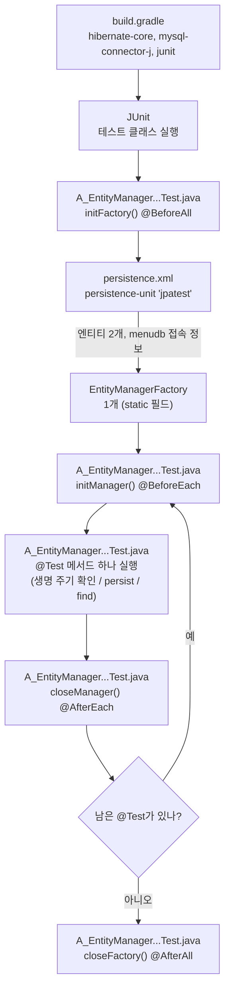

단계별 설명:

1. `build.gradle`: Hibernate(JPA 구현체), MySQL 드라이버, JUnit을 가져온다. Spring 의존성은 없다.
2. JUnit이 테스트 클래스(`A_EntityManagerLifeCycleTests` 또는 `A_EntityManagerCRUDTest`)를 실행한다.
3. `initFactory()`: `persistence.xml`의 `jpatest` 설정을 읽어 EMF를 만든다. 클래스마다 딱 한 번.
4. `initManager()`: `@Test` 하나가 시작되기 전마다 EM을 새로 만든다.
5. `@Test` 메서드 하나를 실행한다. section01은 EMF·EM 확인, section02는 `persist`/`find`.
6. `closeManager()`: 테스트 하나가 끝날 때마다 EM을 닫는다. 남은 테스트가 있으면 4로 돌아간다.
7. `closeFactory()`: 모든 테스트가 끝나면 EMF를 닫는다.

#### 실행 예시 (손으로 추적)

IntelliJ에서 클래스 이름 옆 ▶ 를 누르거나, 클래스 안에서 `Ctrl + Shift + R`.
MySQL이 켜져 있고 `menudb`가 있다면 예상 결과:

```text
✔ A_EntityManagerLifeCycleTests
   ✔ 테스트_메소드()
   ✔ 엔티티매니저_팩토리_생성_확인1()
   ✔ 엔티티매니저_팩토리_생성_확인2()

✔ A_EntityManagerCRUDTest
   ✔ 새로운_메뉴_추가_테스트()
   ✔ 메뉴코드로_메뉴_조회_테스트()
```

- 같은 클래스 안 테스트의 실행 순서는 JUnit이 정한다. 위 순서와 다를 수 있다.
- `새로운_메뉴_추가_테스트()`는 **commit까지** 하므로, 실행할 때마다 `tbl_menu`에 "스파이시 에그마요 샌드위치"가 한 줄씩 늘어난다.

---

### 2단계 (파일·메서드별 흐름) — 설정 한 줄, 애너테이션 하나, 메서드 하나씩

#### 설명

**`persistence.xml` — 줄별 의미**

| 줄 | 의미 |
| --- | --- |
| `<persistence-unit name="jpatest">` | EMF를 식별하는 이름. `createEntityManagerFactory("jpatest")`의 문자열과 **같아야** 한다 |
| `<class>com.bear.practice.Menu</class>` | 관리할 엔티티 (Practice용) |
| `<class>com.bear.section02.crud.Menu</class>` | 관리할 엔티티 (CRUD 테스트용). Spring Boot처럼 패키지를 자동으로 훑어 주지 않으므로 직접 적는다 |
| `jakarta.persistence.jdbc.driver` | `com.mysql.cj.jdbc.Driver` (JDBC 때 쓰던 그 드라이버) |
| `jakarta.persistence.jdbc.url` | `jdbc:mysql://localhost:3306/menudb` |
| `jakarta.persistence.jdbc.user` / `password` | DB 계정 |
| `hibernate.show_sql` | JPA가 실행하는 SQL을 콘솔에 출력 |
| `hibernate.format_sql` | SQL을 줄바꿈해서 보기 좋게 출력 |
| `hibernate.highlight_sql` | SQL 키워드에 색을 입혀 출력 |

**`section02/crud/Menu.java` — 애너테이션 (주석 내용)**

| 애너테이션 | 의미 |
| --- | --- |
| `@Entity(name="section02_menu")` | 엔티티 객체로 만들기 위한 애너테이션. `name`은 JPA 안에서 부르는 엔티티 이름 |
| `@Table(name="tbl_menu")` | 데이터베이스에 매핑될 테이블 이름 |
| `@Id` | PK 속성에 지정 |
| `@Column(name="menu_code")` | 데이터베이스에 대응되는 컬럼명 (다른 필드도 같은 방식) |
| `@GeneratedValue(strategy = GenerationType.IDENTITY)` | 기본키 값 생성(auto-increment)을 데이터베이스가 하도록 함. 즉 PK 번호는 **데이터베이스에 맡기겠다** |

- `practice/Menu.java`와 비교하면 다른 점은 두 가지다: 엔티티 이름(`practice_menu` ↔ `section02_menu`)과 `@GeneratedValue`의 유무.

**`A_EntityManagerLifeCycleTests.java` — 메서드별 역할**

| 메서드 | 애너테이션 | 하는 일 |
| --- | --- | --- |
| `initFactory()` | `@BeforeAll` (static) | 전체 테스트 전에 딱 한 번. `Persistence.createEntityManagerFactory("jpatest")` |
| `initManager()` | `@BeforeEach` | 테스트 메서드가 각각 호출되기 전에. `entityManagerFactory.createEntityManager()` |
| `closeManager()` | `@AfterEach` | 테스트 하나가 끝날 때마다 `entityManager.close()` |
| `closeFactory()` | `@AfterAll` (static) | 모든 테스트가 끝난 뒤 `entityManagerFactory.close()` |
| `테스트_메소드()` | `@Test` | given / when / then 연습: `TestClass.sampleTest()` 결과가 `null`이 아닌지 검증 |
| `엔티티매니저_팩토리_생성_확인1()` / `확인2()` | `@Test` | 똑같은 코드 두 개. EMF와 EM의 `hashCode()`를 출력해 두 테스트끼리 **비교** |

- `initFactory()` 주석의 네 가지 일: ① `persistence.xml`을 읽어 DB 연결 정보와 엔티티 목록 파악 → ② 메타 데이터 처리(엔티티 클래스 구조·관계 정보 저장) → ③ 커넥션 풀 초기화 → ④ 캐시 초기화.
- `TestClass`는 `src/main`, 테스트는 `src/test`에 있지만 **패키지 이름이 같아서**(`com.bear.section01.lifecycle`) `import` 없이 쓴다.

**`A_EntityManagerCRUDTest.java` — 메서드별 역할** (준비·정리 4개는 위와 같음)

| 메서드 | given | when | then |
| --- | --- | --- | --- |
| `새로운_메뉴_추가_테스트()` | `new Menu()` + setter 4개 (메뉴 이름·가격·카테고리·주문 가능 여부, **menuCode는 안 넣음**) | `begin()` → `persist(menu)` → `commit()` (예외 시 `rollback()`) | `assertTrue(entityManager.contains(menu))` — 영속 상태인가 |
| `메뉴코드로_메뉴_조회_테스트()` | `int menuCode = 2` | `entityManager.find(Menu.class, menuCode)` | `assertNotNull(foundMenu)`, `assertEquals(menuCode, foundMenu.getMenuCode())`, 콘솔 출력 |

- `새로운_메뉴_추가_테스트()`는 코드에 `// given`, `// when` 주석으로 구역을 나눴다. then 구역은 `contains(menu)` 검증이다.
- 코드 주석으로 보는 등록 과정 (줄 순서대로):

| 코드 | 주석 |
| --- | --- |
| `entityTransaction.begin();` | 트랜잭션 시작 |
| `entityManager.persist(menu);` | 새로운 엔티티 객체(여기에서는 `menu`)를 퍼시스턴스(영속성) 컨텍스트에 등록 |
| (persist 위 3줄 주석) | `persist()`는 엔티티를 컨텍스트에 등록만 하고, insert 구문은 commit 시점까지 쓰기 지연 저장소에 모았다가 한 번에 보낸다. 그런데 `IDENTITY` 전략에서는 컨텍스트에 저장할 ID 값이 필요하므로, 미리 알기 위해 insert가 바로 실행된다 |
| `entityTransaction.commit();` | 데이터베이스에 반영 |
| `//entityTransaction.rollback();` | 주석 처리된 줄. commit 대신 rollback을 해 보는 실험용 |
| `catch` → `entityTransaction.rollback();` | 예외가 나면 되돌리고 `e.printStackTrace()`로 내용 출력 |
| `assertTrue(entityManager.contains(menu));` | `contains(menu)`: 해당 객체가 persistence context에 등록이 되어 있는지 확인하는 메서드 |

- 등록은 데이터를 바꾸므로 트랜잭션이 필요하고, 조회는 읽기만 하므로 트랜잭션 없이 한다.
- 등록 코드는 `try`에서 `persist()`와 `commit()`을 하고, 예외가 나면 `catch`에서 `rollback()` 후 `e.printStackTrace()`로 내용을 출력한다 (JDBC 때와 같은 패턴).

#### 다이어그램

**메서드 흐름: `initFactory()`** (주석의 ①~④)

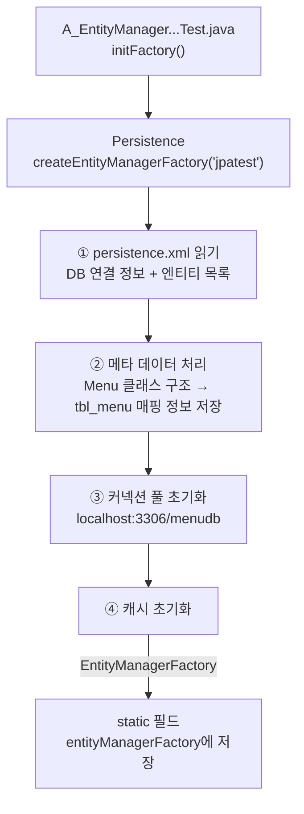

1. `initFactory()`가 `Persistence.createEntityManagerFactory("jpatest")`를 호출한다.
2. ① `META-INF/persistence.xml`에서 `jpatest` 유닛을 찾아 접속 정보와 `<class>` 2개를 읽는다.
3. ② 두 `Menu.java`의 `@Entity`, `@Table`, `@Id`, `@Column`, `@GeneratedValue`를 읽어 "어느 필드가 어느 컬럼인지" 정보를 만든다.
4. ③ `menudb`에 연결할 커넥션 풀을 준비한다.
5. ④ 캐시를 준비한다.
6. 완성된 EMF를 static 필드에 저장한다.

**메서드 흐름: `테스트_메소드()`** (given / when / then)

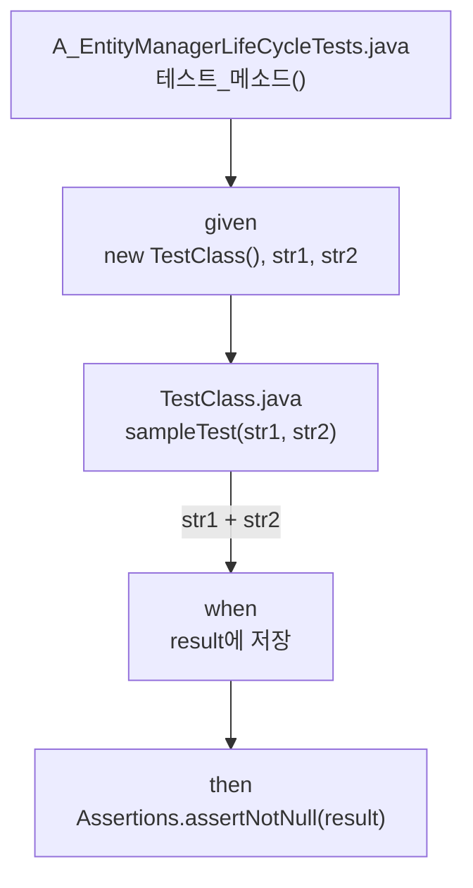

1. given: `TestClass` 객체와 입력 문자열 두 개를 준비한다.
2. when: `sampleTest()`가 `str1 + str2`를 돌려주고 `result`에 담긴다.
3. then: `result`가 `null`이 아닌지 검증한다.

**흐름: `확인1()` → `확인2()`** (두 테스트를 이어서 실행할 때)

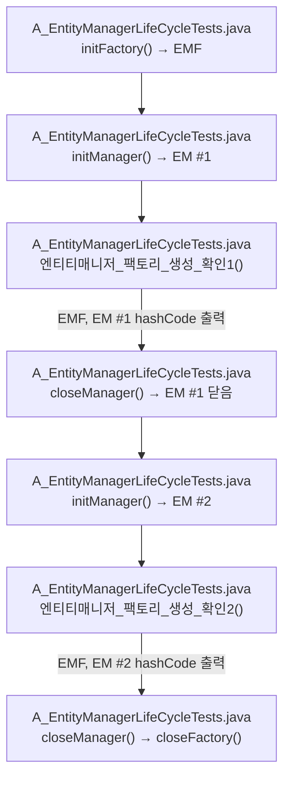

1. EMF는 처음에 한 번 만들어진다.
2. `확인1()` 전에 EM #1이 만들어지고, EMF와 EM #1의 `hashCode()`가 출력된다.
3. EM #1이 닫힌다.
4. `확인2()` 전에 EM #2가 **새로** 만들어지고, EMF와 EM #2의 `hashCode()`가 출력된다.
5. 마지막에 EM #2와 EMF가 닫힌다.

**메서드 흐름: `새로운_메뉴_추가_테스트()`**

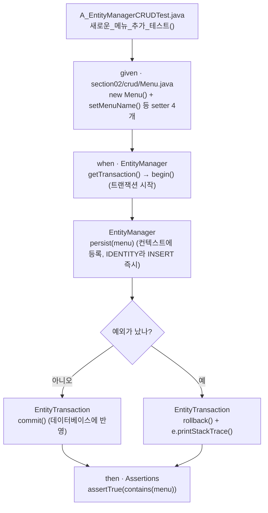

1. `Menu` 객체를 기본 생성자로 만들고 setter로 이름·가격·카테고리·주문 가능 여부를 넣는다. `menuCode`는 넣지 않는다 (DB가 만들어 줌).
2. EM에서 트랜잭션을 꺼내 `begin()`한다.
3. `persist(menu)`로 영속성 컨텍스트에 맡긴다. (IDENTITY라서 이때 INSERT가 바로 나간다 → 3단계)
4. 문제가 없으면 `commit()`으로 확정, 예외가 나면 `rollback()`하고 예외 내용을 출력한다.
5. 마지막으로 `menu`가 아직 영속 상태인지 검증한다.

**메서드 흐름: `메뉴코드로_메뉴_조회_테스트()`**

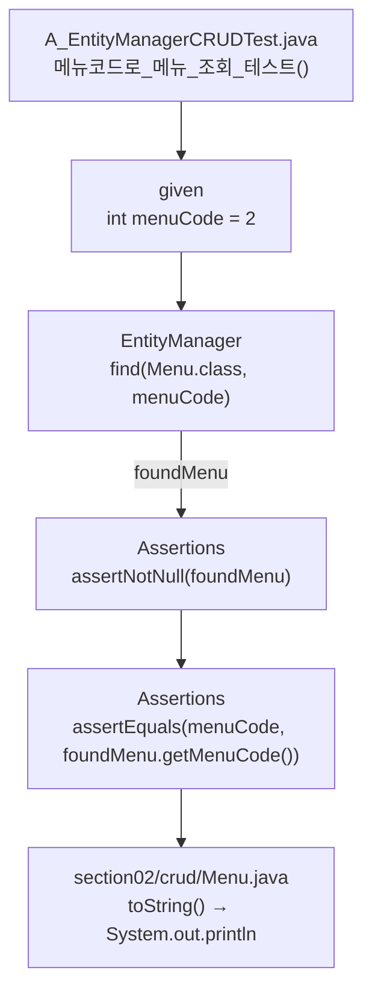

1. 찾을 메뉴 번호 2를 준비한다.
2. `find(Menu.class, 2)`: `Menu.class`로 "어느 엔티티(어느 테이블)인지", `2`로 "어느 PK인지"를 알려 준다.
3. 결과가 `null`이 아닌지 (2번 메뉴가 있는지) 검증한다.
4. 찾은 메뉴의 번호가 정말 2인지 검증한다.
5. `toString()` 결과를 콘솔에 출력한다.

#### 실행 예시 (손으로 추적)

`테스트_메소드()`:

```text
given : str1 = "첫번째 문자", str2 = "두번째 문자"
when  : result = "첫번째 문자두번째 문자"
then  : assertNotNull(result) → 통과
```

`확인1()`, `확인2()` 콘솔 출력 (숫자는 예시):

```text
entityManagerFactory = 1523553211   ← 확인1
entityManager = 2012846597
entityManagerFactory = 1523553211   ← 확인2: EMF 숫자가 같다 → 같은 공장을 공유
entityManager = 1489092624          ← 확인2: EM 숫자가 다르다 → 테스트마다 새 작업자
```

`새로운_메뉴_추가_테스트()` 콘솔 (`show_sql` + `format_sql`):

```text
Hibernate:
    insert
    into
        tbl_menu
        (category_code, menu_name, menu_price, orderable_status)
    values
        (?, ?, ?, ?)
```

- `menu_code`가 INSERT 컬럼에 **없다**: DB의 auto-increment가 채운다.
- 실행 뒤 `tbl_menu`에 `(42, '스파이시 에그마요 샌드위치', 5500, 4, 'Y')` 같은 줄이 생긴다 (번호는 예시).

`메뉴코드로_메뉴_조회_테스트()` 콘솔:

```text
Hibernate:
    select
        m1_0.menu_code,
        m1_0.category_code,
        m1_0.menu_name,
        m1_0.menu_price,
        m1_0.orderable_status
    from
        tbl_menu m1_0
    where
        m1_0.menu_code=?
foundMenu = MenuCopy{menuCode=2, menuName='우럭스무디', menuPrice=5000, categoryCode=10, orderableStatus='Y'}
```

- `menu_code`, `menu_name` 같은 컬럼 이름은 `@Column(name=...)`에서, `tbl_menu`는 `@Table`에서 왔다 (② 메타 데이터 처리).
- 출력 맨 앞이 `MenuCopy`인 것은 `toString()`에 그렇게 적혀 있기 때문이다 (아래 점검 메모).

---

### 3단계 (내부 동작) — Hibernate가 공장·작업자를 만들고, persist·find를 처리할 때

#### 설명

**EMF와 EM**

- **EMF = 비싸다, EM = 싸다**: EMF를 만들 때 엔티티 매핑 분석, 커넥션 풀 준비 같은 무거운 일을 한 번에 끝낸다. EM은 그 준비물을 빌려 쓰는 가벼운 객체라 테스트(요청)마다 만들고 버려도 된다.
- **EM = 영속성 컨텍스트 하나**: `createEntityManager()`를 부를 때마다 새 EM과 함께 **빈 영속성 컨텍스트**(빈 1차 캐시, 빈 쓰기 지연 SQL 저장소)가 생긴다. `close()`하면 영속성 컨텍스트도 사라지고, 그 안의 엔티티는 준영속이 된다.
- **💬 1차 캐시는 EM마다 생긴다**: `initFactory()` 주석 ④에 "1차 캐시 초기화"가 있지만, 1차 캐시는 영속성 컨텍스트 안에 있으므로 실제로는 `createEntityManager()` 때 EM마다 새로 생긴다. 공장이 준비하는 것은 여러 EM이 함께 쓰는 캐시(2차 캐시, 쿼리 캐시) 쪽이다.
- **hashCode**: Hibernate에서 EMF의 실제 클래스는 `SessionFactoryImpl`, EM은 `SessionImpl`이다. `hashCode()`를 따로 정의하지 않아 객체마다 다른 값이 나온다 → "같은 숫자 = 같은 객체"로 읽는다. 확실한 비교는 `assertSame(a, b)`(`a == b`).
- **왜 static인가**: JUnit 5는 테스트 메서드마다 테스트 클래스 객체를 **새로** 만든다. EMF는 모든 테스트가 같이 써야 하므로 static 필드, `@BeforeAll`/`@AfterAll` 메서드도 static이다. EM은 테스트마다 새로 만들 것이라 인스턴스 필드다.
- **EMF를 만들 때 DB에 접속한다**: MySQL이 꺼져 있으면 `initFactory()`에서 예외가 나고, 그 클래스의 테스트가 **전부** 실패한다. DB를 안 쓰는 `테스트_메소드()`도 포함이다.
- **persistence.xml 위치**: `Persistence`는 클래스패스의 `META-INF/persistence.xml`을 찾는다. 지금은 `src/test/resources`에 있어서 **테스트 코드에서만** 찾을 수 있다.

**persist() — IDENTITY라서 INSERT가 바로 나간다**

코드 주석 그대로: "persist()는 엔티티를 퍼시스턴스 컨텍스트에 등록만 하고, insert 구문은 commit 시점까지 쓰기 지연 저장소에 모았다가 한 번에 보낸다. 그런데, `@GeneratedValue(strategy = GenerationType.IDENTITY)` 전략에 의해 컨텍스트에 저장할 ID 값이 필요하므로 미리 알기 위해 insert가 바로 실행된다."

- **원래 규칙**: `persist()`는 INSERT SQL을 쓰기 지연 SQL 저장소에 모아 두고, flush/commit 때 한 번에 보낸다.
- **IDENTITY는 예외**: 1차 캐시의 key는 `Menu#PK`다. 그런데 `IDENTITY`는 PK 번호를 **데이터베이스에 맡겼기** 때문에(`Menu.java` 주석), 번호는 DB가 INSERT를 실행할 때 비로소 생긴다. 그래서 JPA는 key를 알기 위해 `persist()` 순간 INSERT를 **즉시** 실행하고, DB가 만든 번호를 `menu.menuCode`에 채운 뒤 1차 캐시에 `Menu#42`로 등록한다.
- `commit()`은 그 INSERT를 **확정**한다. commit 전에 예외가 나서 `rollback()`하면 INSERT는 취소된다.
- **commit 뒤에도 `contains(menu)`가 `true`인 이유**: commit은 트랜잭션을 끝낼 뿐, 영속성 컨텍스트를 닫지 않는다. EM이 열려 있는 동안 `menu`는 계속 영속 상태다. `closeManager()`의 `close()` 때 비로소 준영속이 된다.

**find() — `Menu.class`가 테이블을, `2`가 행을 정한다**

- `find(Menu.class, 2)`는 1차 캐시에서 `Menu#2`를 먼저 찾고, 없으면 SELECT를 보낸 뒤 결과를 1차 캐시에 넣고 돌려준다. 같은 EM으로 한 번 더 찾으면 SQL 없이 같은 객체가 나온다.
- 해당 PK의 행이 없으면 예외가 아니라 `null`을 돌려준다 → 그래서 `assertNotNull`로 먼저 확인한다.
- `int menuCode`는 `find()`에 넘길 때 자동으로 `Integer`가 된다(오토박싱). `@Id` 필드 타입(`int`)과 맞아서 문제없다.
- 이 테스트 안의 `Menu`는 같은 패키지의 `com.bear.section02.crud.Menu`다.

**Menu 클래스가 두 개인데 괜찮은 이유**

- `practice/Menu`와 `section02/crud/Menu`는 클래스 이름이 같다. 엔티티 이름을 따로 안 주면 둘 다 기본값 `Menu`가 되어 JPA 안에서 이름이 겹친다.
- 그래서 `@Entity(name="practice_menu")`, `@Entity(name="section02_menu")`로 이름을 나눴다. 테이블은 둘 다 `tbl_menu`를 봐도 된다.

#### 다이어그램

**메서드 흐름: `createEntityManager()`와 `close()` 안에서 일어나는 일**

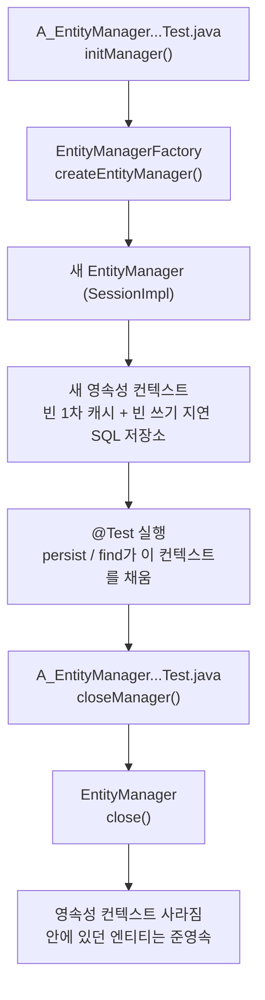

1. `initManager()`가 공장에 EM을 요청한다.
2. Hibernate가 새 `SessionImpl`(EM)과 빈 영속성 컨텍스트를 만든다.
3. 테스트에서 `persist()`, `find()`를 부르면 이 컨텍스트의 1차 캐시가 채워진다.
4. `close()`하면 컨텍스트가 통째로 사라지고, 들고 있던 엔티티는 준영속이 된다.

**메서드 흐름: `persist(menu)` 안에서 (IDENTITY일 때)**

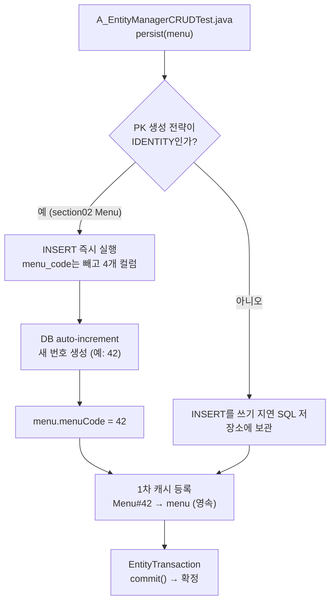

1. `persist(menu)`가 불리면 엔티티의 PK 생성 전략을 본다.
2. `IDENTITY`면 PK를 DB가 만들어야 하므로 INSERT를 바로 보낸다.
3. DB가 auto-increment로 번호를 만들고, Hibernate가 그 번호를 `menuCode`에 채운다.
4. 그 번호를 key로 1차 캐시에 등록한다 (영속 상태).
5. 전략이 IDENTITY가 아니면 INSERT를 모아 두었다가 commit 때 보낸다.
6. `commit()`으로 확정한다.

#### 실행 예시 (손으로 추적)

`새로운_메뉴_추가_테스트()` — 객체 상태와 1차 캐시:

```text
new Menu()                    // menuCode = 0, 비영속
setMenuName(...) 등 4개        // 값만 채움, 아직 비영속
begin()
persist(menu)                 // IDENTITY → INSERT 즉시 → menuCode = 42 (예시)
                              // 1차 캐시: { Menu#42 : menu } → 영속
commit()                      // INSERT 확정 (DB에 한 줄 추가)
contains(menu)                // true (EM이 아직 열려 있음) → 테스트 통과
closeManager()                // 컨텍스트 사라짐 → menu 준영속
```

`메뉴코드로_메뉴_조회_테스트()` — 1차 캐시:

```text
find(Menu.class, 2)           // 1차 캐시 비어 있음 → SELECT ... WHERE menu_code = 2
                              // 1차 캐시: { Menu#2 : foundMenu(우럭스무디) }
assertNotNull / assertEquals  // 통과
(같은 EM으로 find(Menu.class, 2)를 또 부르면 → SQL 없이 같은 객체)
```

MySQL이 꺼져 있을 때 (예상):

```text
✘ initFactory()에서 예외 (DB 연결 실패)
→ 그 클래스의 @Test가 모두 실행되지 못하고 실패로 표시
```

**바꿔 보면 어떻게 될까**

- `commit()` 줄을 지우면 → `persist()` 때 INSERT는 나가지만 확정되지 않아 DB에 남지 않는다.
- `commit()` 대신 주석 처리된 `//entityTransaction.rollback();`을 살리면 → 콘솔에는 INSERT가 찍히지만(IDENTITY) rollback으로 취소되어 `tbl_menu`에 새 줄이 생기지 않는다. 이때 `contains(menu)`가 `true`일지 `false`일지는 직접 실행해서 확인해 보자.
- 두 `Menu`의 `@Entity(name=...)`을 모두 지우면 → 엔티티 이름 `Menu`가 겹쳐 `initFactory()`에서 예외가 난다.
- `persistence.xml`에서 `<class>com.bear.section02.crud.Menu</class>`를 지우면 → Hibernate가 이 클래스를 엔티티로 모르므로 `persist`/`find`에서 예외가 날 수 있다.
- EMF를 `@BeforeEach`(인스턴스 필드)로 바꾸면 → 테스트마다 공장을 새로 만들어 매번 느려지고, `확인1`/`확인2`의 EMF 숫자도 달라진다.
- EM을 `@BeforeAll`로 바꾸면 → `확인1`/`확인2`의 EM 숫자가 같아지고, 앞 테스트의 1차 캐시가 다음 테스트에 남는다.

---

### 4. 함께 고친 것 (오타만) · 점검 메모

- ✅ `A_EntityManagerLifeCycleTests.java` 메서드 이름 `엔티티메니저_팩토리_생성_확인1()` / `확인2()` → `엔티티매니저_...` (이름만 바뀜, 동작 변화 없음)
- ✅ `section02/crud/Menu.java` 주석 `PK 속성에 지점` → `PK 속성에 지정`
- ✅ `A_EntityManagerCRUDTest.java` 주석 `트랜젝션 시작` → `트랜잭션 시작`
- ✅ `A_EntityManagerCRUDTest.java` 주석 `퍼시스트 컨텍스트`, `퍼시스트(영속성) 컨텍스트` → `퍼시스턴스 컨텍스트`, `퍼시스턴스(영속성) 컨텍스트` (persistence)
- 💬 `A_EntityManagerCRUDTest.java`의 `import com.bear.section01.lifecycle.TestClass;`는 쓰이지 않는다. `Ctrl + Option + O`(Optimize Imports)로 정리할 수 있다.
- 💬 두 `Menu.java`의 `toString()`이 모두 `"MenuCopy{"`로 시작한다 (복사해 온 클래스 이름이 남은 것으로 보임). 출력 문자열이라 고치지 않았다.
- 💬 `새로운_메뉴_추가_테스트()`는 실제로 commit하므로 실행할 때마다 같은 메뉴가 한 줄씩 늘어난다. 여러 번 실행했다면 Workbench에서 `tbl_menu`를 확인해 보자.

---

## 🧪 Practice.java — 3단계로 보는 "영속성 컨텍스트 예측 문제 5개"

> 파일: `04_SpringBoot/04_JPA/chap01-persistence-context/src/test/java/com/bear/practice/Practice.java` (엔티티는 같은 패키지의 `Menu.java`)
> 1단계는 큰 그림, 2단계는 메서드별 흐름, 3단계는 영속성 컨텍스트 안에서 일어나는 일. 각 단계는 **설명 → 다이어그램 → 실행 예시** 순서.
> 실행하지 않았고 전부 **손으로 추적**했다. 1~3단계에는 정답을 적지 않았고, 정답(결과에 이르는 흐름과 테스트 결과)은 맨 뒤 **4. 문제별 결과까지의 흐름**에 모았다. 먼저 예측해 본 뒤 4번을 보자.

---

### 1단계 (개괄) — 이 파일은 무엇을 하나

#### 설명

- JUnit 5 테스트 클래스다. `@Test` 메서드 5개가 각각 "이렇게 하면 어떻게 될까?"를 묻는다.
- 준비·정리 메서드 4개는 위 마지막 그림(강사님 코드 ①~⑤)과 **같은 구조**다.
  - `initFactory()` `@BeforeAll` → 공장(EMF) 1개
  - `initManager()` `@BeforeEach` → 테스트마다 새 작업자(EM) + 새 영속성 컨텍스트
  - `closeManager()` `@AfterEach`, `closeFactory()` `@AfterAll` → 정리
- 비유: EMF = 공장, EM = 공장에서 나온 작업자, 영속성 컨텍스트 = 그 작업자의 **개인 작업대**. 테스트마다 작업자가 바뀌니 작업대(1차 캐시)도 새것이다 → 테스트끼리 영향을 주지 않는다.
- 모든 테스트에 `@Disabled("성공/실패를 예측한 뒤 이 애너테이션을 제거하고 실행하세요.")`가 붙어 있다. 실행해도 건너뛴다(skipped). 예측을 먼저 하라는 장치다.

#### 다이어그램

**JUnit이 Practice 클래스를 실행하는 순서**

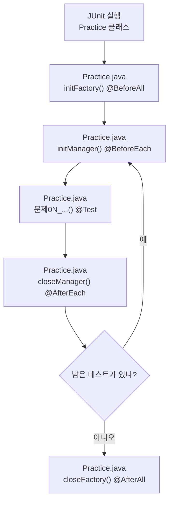

단계별 설명:

1. `Practice.java` `initFactory()`: 테스트가 시작되기 전에 **한 번**, `persistence.xml`의 `jpatest` 설정으로 EMF를 만든다.
2. `Practice.java` `initManager()`: 테스트 하나가 시작될 때마다 EM을 새로 만든다. 빈 영속성 컨텍스트도 함께 생긴다.
3. `Practice.java` `문제0N_...()`: 테스트 본문을 실행한다.
4. `Practice.java` `closeManager()`: 테스트가 끝날 때마다 EM을 닫는다. 영속성 컨텍스트도 같이 사라진다.
5. 남은 테스트가 있으면 2로 돌아간다.
6. `Practice.java` `closeFactory()`: 모든 테스트가 끝나면 EMF를 닫는다.

#### 실행 예시 (손으로 추적)

문제01, 문제02의 `@Disabled`만 지우고 클래스 전체를 실행한다고 가정:

```text
initFactory()     // EMF 1개 생성 ("jpatest")
initManager()     // EM #1 → 빈 영속성 컨텍스트 #1
문제01_...()
closeManager()    // EM #1 닫음 → 컨텍스트 #1 사라짐
initManager()     // EM #2 → 빈 영속성 컨텍스트 #2 (#1과 별개)
문제02_...()
closeManager()
closeFactory()    // EMF 닫음
// 문제03, 04, 05 → skipped (@Disabled)
```

- 테스트 메서드끼리의 순서는 JUnit이 정하며, 소스 순서와 같다고 보장되지 않는다 → 테스트는 서로 독립적이어야 한다.

---

### 2단계 (메서드별 흐름) — 어떤 메서드가 무엇을 부르나

#### 설명

**메서드 역할**

| 메서드 | 애너테이션 | 하는 일 | 이유 |
| --- | --- | --- | --- |
| `initFactory()` | `@BeforeAll` (static) | `Persistence.createEntityManagerFactory("jpatest")` | 만드는 비용이 커서 클래스당 한 번 |
| `initManager()` | `@BeforeEach` | `entityManagerFactory.createEntityManager()` | 테스트마다 빈 영속성 컨텍스트로 시작 |
| `문제01` ~ `문제05` | `@Test` `@Disabled` | 아래 문제 표 | 예측 후 하나씩 실행 |
| `createMenu()` | (private) | `new Menu(menuCode, menuName, 10000, 1, "Y")` | 문제02에서 쓸 새 객체(비영속) |
| `closeManager()` | `@AfterEach` | `entityManager.close()` | 작업대 정리 |
| `closeFactory()` | `@AfterAll` (static) | `entityManagerFactory.close()` | 공장 정리 |

**문제별 호출과 확인하는 개념**

| 문제 | EntityManager 호출 순서 | 검증 | 관련 개념 |
| --- | --- | --- | --- |
| 01 | `find(Menu.class, 2)` 두 번 | `assertSame(firstMenu, secondMenu)` | 1차 캐시 |
| 02 | `getTransaction().begin()` → `persist(newMenu)` | `assertTrue(contains(newMenu))` | 비영속 → 영속 |
| 03 | `begin()` → `find` → `setMenuName` → `flush()` → `clear()` → `find` | `assertEquals(changedName, ...getMenuName())` | 변경 감지, flush, clear |
| 04 | `begin()` → `find` → `remove(foundMenu)` → `find` | `assertNull(find(...))` | 삭제 상태 |
| 05 | `find` → `detach` → `setMenuName` → `merge` | `contains(detachedMenu)`, `contains(mergedMenu)` | 준영속, merge |

- `assertSame(a, b)`: **같은 객체**인가 (`a == b`) / `assertEquals(a, b)`: **값이 같은가** (`a.equals(b)`). 문제01이 왜 `assertSame`을 썼는지 생각해 보자.
- `contains(e)`: 넘겨준 **그 객체**가 지금 영속성 컨텍스트가 관리하는(영속) 객체인지 `true`/`false`.

**함께 필요한 파일**

| 파일 | 역할 | 현재 상태 |
| --- | --- | --- |
| `Practice.java` | 테스트 5개 (`package com.bear.practice`) | 있음 |
| `Menu.java` | `@Entity(name="practice_menu")` + `@Table(name="tbl_menu")`, `@Id int menuCode`, 컬럼 5개, 기본·전체 생성자, getter/setter | 있음 |
| `src/test/resources/META-INF/persistence.xml` | persistence-unit `jpatest`: `menudb` 접속 정보 + `<class>com.bear.practice.Menu</class>` | 있음 |

#### 다이어그램

**문제01 — 같은 식별자로 두 번 조회**

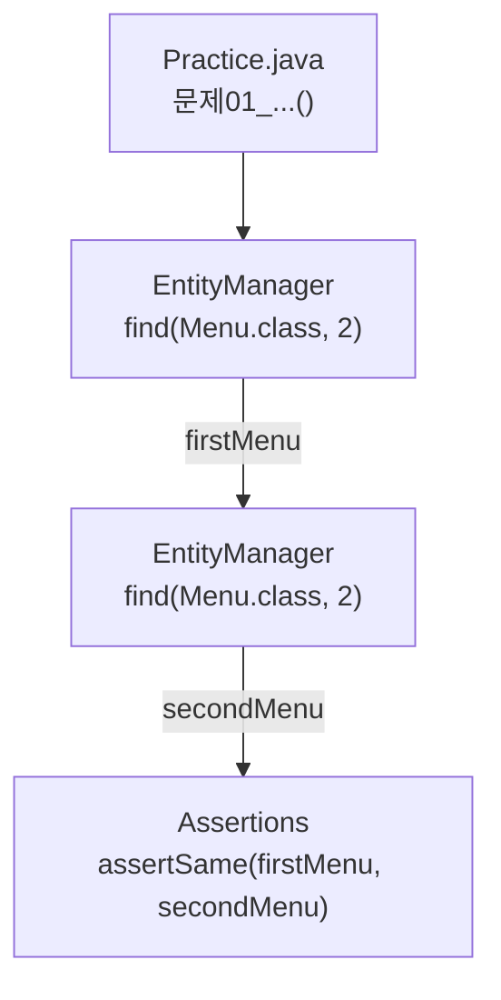

1. 2번 메뉴를 조회해 `firstMenu`에 담는다.
2. 같은 EM으로 같은 식별자를 다시 조회해 `secondMenu`에 담는다.
3. 두 변수가 같은 객체를 가리키는지 검증한다.

**문제02 — persist 후 영속 상태 확인**

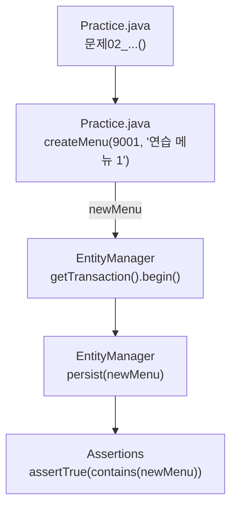

1. `createMenu()`가 `new Menu(...)`로 객체를 만든다. 아직 JPA가 모르는 객체다.
2. 트랜잭션을 시작한다.
3. `persist(newMenu)`로 영속성 컨텍스트에 맡긴다.
4. 이 객체가 지금 관리 대상인지 검증한다.

**문제03 — 값만 바꾼 뒤 flush, clear, 다시 조회**

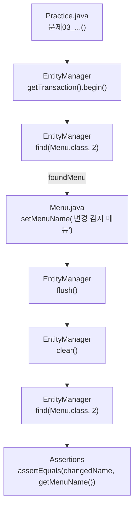

1. 트랜잭션을 시작하고 2번 메뉴를 조회한다.
2. `update()` 같은 메서드 없이 값만 `setMenuName()`으로 바꾼다.
3. `flush()`로 쌓인 SQL을 DB로 보낸다.
4. `clear()`로 영속성 컨텍스트를 비운다.
5. 다시 조회해 이름이 바뀐 값인지 검증한다.

**문제04 — remove 후 같은 컨텍스트에서 다시 조회**

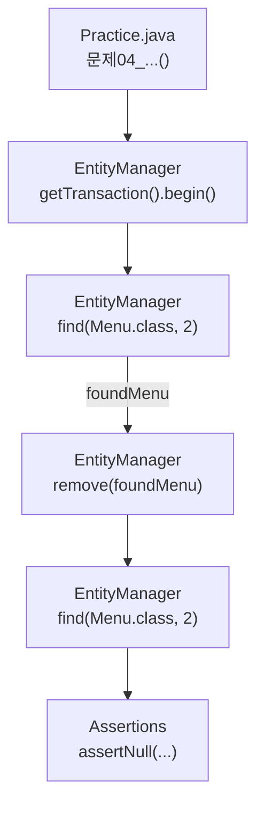

1. 트랜잭션을 시작하고 2번 메뉴를 조회한다.
2. `remove(foundMenu)`로 삭제를 요청한다. `flush()`나 `commit()`은 부르지 않는다.
3. 같은 EM으로 다시 조회해 `null`인지 검증한다.

**문제05 — detach 후 merge**

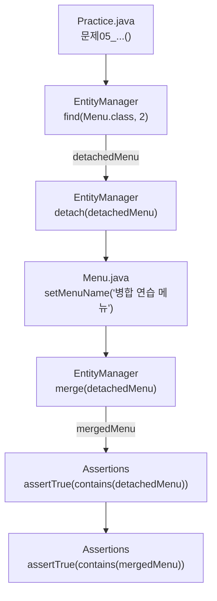

1. 2번 메뉴를 조회한 뒤 `detach()`로 컨텍스트에서 떼어 낸다.
2. 떼어 낸 객체의 이름을 바꾼다.
3. `merge(detachedMenu)`를 호출하고, 돌려받은 값을 `mergedMenu`에 담는다.
4. 넘겨준 객체와 돌려받은 객체가 **각각** 영속 상태인지 따로 검증한다.

#### 실행 예시 — 예측 기록표

예측을 먼저 적고, `@Disabled`를 하나씩 지워 실행한 뒤 실제 결과와 이유를 채운다.

| 문제 | 내 예측 (성공/실패) | 실제 결과 | 이유 |
| --- | --- | --- | --- |
| 01 |  |  |  |
| 02 |  |  |  |
| 03 |  |  |  |
| 04 |  |  |  |
| 05 |  |  |  |

---

### 3단계 (내부 동작) — 영속성 컨텍스트 안에서 일어나는 일

#### 설명

- **1차 캐시**: 영속성 컨텍스트 안의 Map. key = 엔티티 타입 + 식별자(`Menu#2`), value = 엔티티 객체. 처음 영속이 될 때의 복사본 **스냅샷**도 같이 저장한다.
- **find()**: 1차 캐시를 먼저 본다. 없을 때만 DB에 SELECT → 결과를 1차 캐시에 넣고 돌려준다 ("한번 조회한 내용은 또 조회 안 함").
- **쓰기 지연 SQL 저장소**: `persist()`, 값 변경, `remove()`가 일어나도 SQL을 바로 보내지 않고 모아 둔다.
- **flush**: 모아 둔 SQL을 DB로 **보내는** 것. 보낸 SQL은 아직 확정이 아니다 → `commit()`해야 확정, `rollback()`하면 되돌려짐. `commit()`은 내부에서 flush를 먼저 한다.
- **변경 감지 (Dirty Checking)**: flush 때 Entity와 Snapshot을 비교해 달라졌으면 UPDATE SQL을 만든다 → 그래서 `update()` 메서드가 없다.
- **트랜잭션**: 문제02, 03, 04는 `begin()`만 하고 `commit()`이나 `rollback()`이 없다.
- **왜 EMF는 static인가**: JUnit 5는 기본적으로 테스트 메서드마다 `Practice` 객체를 **새로** 만든다. 그래서 모든 테스트가 공유할 `entityManagerFactory`는 static 필드, `@BeforeAll`/`@AfterAll` 메서드도 static이어야 한다. `entityManager`는 테스트마다 새로 만드는 인스턴스 필드다.
- **엔티티 이름 vs 테이블 이름**: `@Entity(name="practice_menu")`는 JPA가 부르는 이름(JPQL에서 사용), `@Table(name="tbl_menu")`가 실제 DB 테이블이다.

#### 다이어그램

**find() 내부 동작**

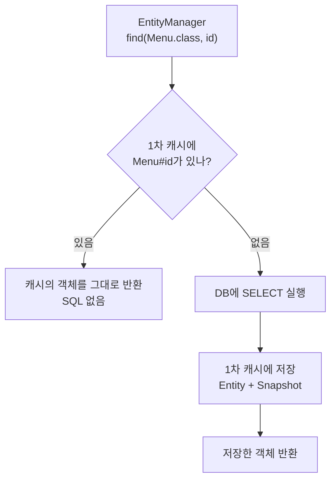

**변경 감지 (수업 그림 2-3의 순서)**

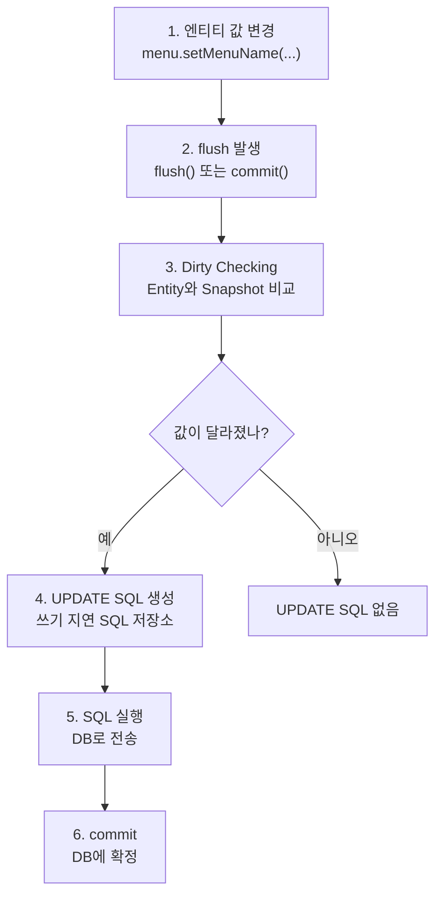

**테스트마다 새 Practice 객체, 공유되는 static EMF**

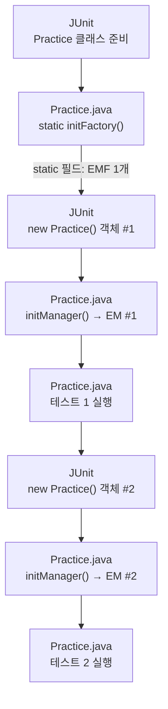

단계별 설명:

1. `find()`는 1차 캐시 → 없으면 DB 순서로 찾고, DB에서 읽은 것은 Entity + Snapshot으로 캐시에 저장한다.
2. 영속 엔티티의 값을 바꾸면 SQL 없이 Entity 칸만 달라지고, flush 때 Snapshot과 비교해 UPDATE가 만들어진다.
3. JUnit은 테스트마다 `Practice` 객체를 새로 만든다. static EMF만 공유되고, EM과 1차 캐시는 테스트마다 따로다.

#### 실행 예시 (손으로 추적)

수업 그림의 `Menu#1`로 1차 캐시가 바뀌는 모습 (Practice 문제의 2번 메뉴가 아님):

```text
transaction.begin()
em.find(Menu.class, 1)   // 캐시에 없음 → SELECT ... WHERE menu_code = 1
                         // 1차 캐시: { Menu#1 : [Entity: 원래 이름, Snapshot: 원래 이름] }
menu.setMenuName("A")    // SQL 없음, 객체 값만 바뀜
                         // 1차 캐시: { Menu#1 : [Entity: "A", Snapshot: 원래 이름] }
em.find(Menu.class, 1)   // 캐시에 있음 → SQL 없음, 같은 객체 반환
transaction.commit()     // flush → Entity ≠ Snapshot → UPDATE ... SET menu_name = 'A' WHERE menu_code = 1
                         // → DB에 확정
```

**문제에 적용해 보기 (정답 대신 질문)**

- 문제01: 두 번째 `find()` 때 1차 캐시에 `Menu#2`가 있을까? `assertSame`은 무엇을 비교할까?
- 문제02: `persist()` 직후 `newMenu`는 생명 주기 그림의 어디에 있을까? INSERT SQL이 아직 DB로 가지 않았다는 사실이 `contains()`에 영향을 줄까?
- 문제03: `clear()` 뒤의 `find()`는 1차 캐시와 DB 중 어디서 읽을까? 같은 트랜잭션 안에서 flush로 보낸 UPDATE가 그 조회에 보일까?
- 문제04: 삭제 상태로 표시된 엔티티를 `find()`하면 영속성 컨텍스트는 무엇을 돌려줘야 할까? DELETE SQL이 아직 DB로 가지 않았다는 점과 함께 생각해 보자.
- 문제05: `merge()`가 돌려준 `mergedMenu`와 넘겨준 `detachedMenu`는 같은 객체일까? 문제 이름의 "준영속 객체 **자체가**"에 주목하자.
- 공통: `commit()`이 없으니, 테스트가 끝난 뒤 DB의 2번 메뉴와 9001번 메뉴는 어떤 상태일까?

**바꿔 보면 어떻게 될까**

- `initManager()`를 `@BeforeAll`로 바꿔 EM 하나를 모든 테스트가 같이 쓰면 → 앞 테스트의 1차 캐시가 다음 테스트에 남아, 결과가 테스트 순서에 따라 달라질 수 있다.
- `initFactory()`에서 `static`을 빼면 → JUnit이 실행 전에 에러를 낸다 (기본 설정에서 `@BeforeAll` 메서드는 static이어야 함).

---

### 4. 문제별 결과까지의 흐름 (정답)

> 손으로 추적한 결과다 (실행하지 않음). 전제: `@Disabled`를 지우고 실행, MySQL이 켜져 있고 `tbl_menu`에 2번 메뉴가 있다.
> 각 흐름에서 **1차 캐시**(영속성 컨텍스트)와 **DB**가 어떻게 바뀌는지를 같이 따라간다. `practice/Menu`는 `@GeneratedValue`가 없어서 PK를 직접 넣는 엔티티다.

#### 문제01 — 같은 식별자로 두 번 조회하면 같은 객체일까? → ✅ 성공

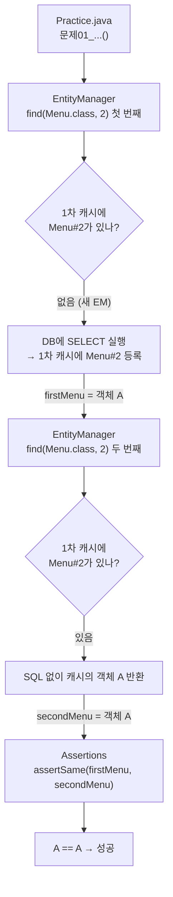

1. `initManager()`가 만든 새 EM이라 1차 캐시는 비어 있다.
2. 첫 번째 `find()`: 캐시에 없으므로 SELECT를 보내고, 결과 객체(A)를 `Menu#2`로 1차 캐시에 넣은 뒤 돌려준다.
3. 두 번째 `find()`: 캐시에 `Menu#2`가 있으므로 **SQL 없이** 같은 객체 A를 돌려준다.
4. `assertSame`은 `==`로 비교한다. 두 변수가 같은 객체 A를 가리키므로 **성공**.

- 콘솔 SQL: SELECT **1번**만 찍힌다. (수업 메모 "한번 조회한 내용은 또 조회 안 함!")
- 참고: 2번 메뉴가 없으면 두 번 다 `null` → `assertSame(null, null)`도 통과한다. 이 테스트는 "메뉴가 있다"까지는 확인하지 않는다.

#### 문제02 — persist하면 엔티티는 영속 상태가 될까? → ✅ 성공

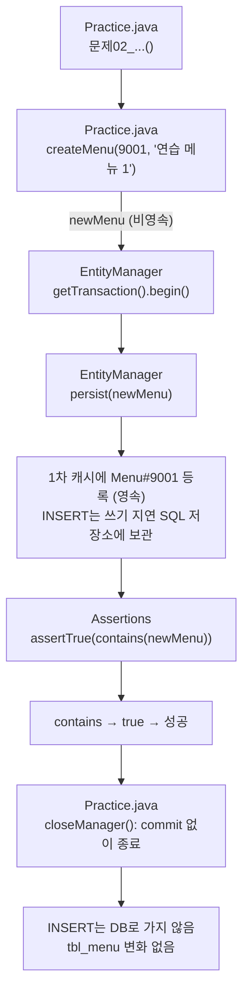

1. `createMenu()`가 만든 `newMenu`는 **비영속**이다. PK 9001은 코드가 직접 넣었다.
2. 트랜잭션을 시작하고 `persist(newMenu)`를 부른다.
3. `practice/Menu`는 `@GeneratedValue`가 없다 → PK를 이미 알고 있으므로 INSERT를 바로 보낼 필요가 없다. 1차 캐시에 `Menu#9001`로 등록(영속)하고, INSERT는 쓰기 지연 SQL 저장소에 넣어 둔다. (section02의 IDENTITY와 다른 점)
4. `contains(newMenu)`는 "그 객체가 지금 영속 상태인가"를 본다. 방금 등록했으므로 `true` → **성공**.
5. flush도 commit도 없이 EM이 닫히므로 INSERT는 DB로 가지 않는다.

- 콘솔 SQL: **없음**.
- "INSERT가 아직 안 나갔는데 영속인가?" → 영속은 **영속성 컨텍스트에 등록됐는가**의 문제이고, DB에 저장됐는지와는 별개다.

#### 문제03 — 영속 엔티티의 값만 바꾸면 변경을 감지할까? → ✅ 성공

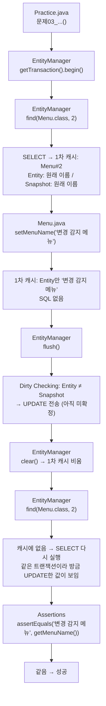

1. 트랜잭션을 시작하고 2번 메뉴를 조회한다. 1차 캐시에 Entity와 Snapshot이 같은 값으로 저장된다.
2. `setMenuName()`으로 값만 바꾼다. Entity 칸만 달라지고 SQL은 없다.
3. `flush()`: Entity와 Snapshot을 비교해(변경 감지) 이름이 다르므로 UPDATE를 만들어 DB로 **보낸다**. commit 전이라 확정은 아니다.
4. `clear()`: 1차 캐시를 비운다. 이제 `foundMenu`는 준영속이다.
5. 다시 `find(Menu.class, 2)`: 캐시가 비어 있으니 **SELECT를 다시** 보낸다. 같은 트랜잭션(같은 DB 연결) 안이라 방금 보낸 UPDATE가 반영된 값을 읽는다.
6. 읽어 온 이름이 `"변경 감지 메뉴"`이므로 **성공**.

- 콘솔 SQL: SELECT → UPDATE → SELECT (3번).
- `clear()`가 핵심이다. `clear()`가 없으면 두 번째 `find()`는 SQL 없이 캐시의 객체를 돌려주므로, "DB에 정말 반영됐는지"를 확인할 수 없다.
- commit이 없으므로 UPDATE는 **확정되지 않고** 테스트가 끝나면 사라진다. DB의 2번 메뉴 이름은 그대로다.

##### 문제03 상세 — 호출과 데이터 이동을 단계별로

> `Practice.java` 61~72번째 줄을 6개 구간으로 나눴다. 구간마다 **누가 누구를 호출하는지**(실선)와 **값이 어디서 어디로 옮겨 가는지**(라벨)를 그렸다. 2번 메뉴의 원래 이름은 어제 실행 결과의 `우럭스무디`로 가정했다 (CRUD의 수정 테스트를 실행했다면 `갈치스무디`). 손으로 추적했고 실행하지 않았다.

**구간 ① 준비 — `@BeforeEach` → 62~63번째 줄: 트랜잭션 시작**

```mermaid
flowchart TD
    A["JUnit<br/>new Practice() 객체 생성"] --> B["Practice.java<br/>initManager() @BeforeEach"]
    B --> C["EntityManagerFactory<br/>createEntityManager()"]
    C -->|"EM 반환"| D["EntityManager (새것)<br/>영속성 컨텍스트: 1차 캐시 비어 있음<br/>쓰기 지연 SQL 저장소 비어 있음"]
    D --> E["Practice.java 62<br/>entityManager.getTransaction()"]
    E -->|"EntityTransaction 반환"| F["Practice.java 63<br/>transaction.begin()"]
    F --> G["커넥션 풀에서 DB 연결 1개를 빌림<br/>자동 커밋 끔 (트랜잭션 시작)"]
```

1. JUnit이 테스트용 `Practice` 객체를 새로 만들고 `initManager()`를 부른다.
2. 공장이 새 EM을 돌려준다. 이 EM의 1차 캐시와 쓰기 지연 SQL 저장소는 비어 있다.
3. 62번째 줄: EM에서 트랜잭션 객체를 꺼낸다.
4. 63번째 줄: `begin()`이 DB 연결을 하나 잡고 자동 커밋을 끈다. 이후 이 테스트의 SQL은 모두 **이 연결, 이 트랜잭션** 안에서 실행된다.

**구간 ② 64번째 줄: `find(Menu.class, 2)` — DB → 객체 → 1차 캐시**

```mermaid
flowchart TD
    A["Practice.java 64<br/>entityManager.find(Menu.class, 2)"] --> B{"1차 캐시에<br/>Menu#2가 있나?"}
    B -->|"없음"| C["Hibernate<br/>SELECT SQL 생성<br/>(@Table, @Column 정보 사용)"]
    C --> D["JDBC → MySQL<br/>SELECT ... FROM tbl_menu WHERE menu_code = 2"]
    D -->|"행 1개: 2, 우럭스무디, 5000, 10, Y"| E["Hibernate<br/>new Menu() 후 필드에 값 채움<br/>= 객체 A"]
    E --> F["스냅샷 저장<br/>객체 A의 값을 복사해 따로 보관"]
    F --> G["1차 캐시 등록<br/>Menu#2 → 객체 A (영속)"]
    G -->|"객체 A 반환"| H["Practice.java 64<br/>foundMenu = 객체 A"]
```

1. `find()`는 먼저 1차 캐시에서 `Menu#2`를 찾는다. 새 EM이라 없다.
2. Hibernate가 `Menu` 클래스의 매핑 정보로 SELECT를 만들어 DB로 보낸다.
3. 돌아온 행의 값으로 `Menu` 객체 A를 만든다 (기본 생성자 + 필드 채우기).
4. 객체 A의 값을 **복사해서 스냅샷**으로 보관한다. 나중에 비교할 "처음 상태"다.
5. 1차 캐시에 `Menu#2 → 객체 A`로 등록하고, 객체 A를 `foundMenu`에 돌려준다.

**구간 ③ 65~67번째 줄: `setMenuName()` — 객체 안의 값만 바뀜**

```mermaid
flowchart TD
    A["Practice.java 65<br/>changedName = '변경 감지 메뉴'"] --> B["Practice.java 67<br/>foundMenu.setMenuName(changedName)"]
    B --> C["Menu.java<br/>setMenuName(): this.menuName = menuName"]
    C --> D["객체 A의 menuName<br/>우럭스무디 → 변경 감지 메뉴"]
    D --> E["1차 캐시의 Menu#2도 객체 A 자체이므로<br/>캐시 쪽 값도 같이 바뀐 것으로 보임"]
    E --> F["스냅샷은 그대로: 우럭스무디<br/>쓰기 지연 저장소: 비어 있음<br/>DB: 우럭스무디 (SQL 없음)"]
```

1. `setMenuName()`은 평범한 자바 setter다. 객체 A의 필드 하나를 바꿀 뿐, Hibernate를 부르지 않는다.
2. 1차 캐시는 객체 A의 **참조**를 들고 있으므로, 캐시에서 보이는 `Menu#2`도 바뀐 이름이다.
3. 스냅샷은 별도의 복사본이라 그대로 `우럭스무디`다. 이제 Entity와 Snapshot이 **다르다**.
4. 아직 SQL은 하나도 만들어지지 않았다.

**구간 ④ 68번째 줄: `flush()` — 변경 감지 → UPDATE가 DB로 이동**

```mermaid
flowchart TD
    A["Practice.java 68<br/>entityManager.flush()"] --> B["Hibernate<br/>1차 캐시의 엔티티를 하나씩 꺼냄"]
    B --> C["Menu#2: 객체 A의 현재 값과<br/>스냅샷을 필드별로 비교"]
    C --> D{"달라진 필드가 있나?"}
    D -->|"있음: menuName"| E["UPDATE SQL 생성<br/>쓰기 지연 SQL 저장소에 넣음"]
    E --> F["쓰기 지연 저장소의 SQL을<br/>JDBC로 DB에 전송"]
    F -->|"UPDATE tbl_menu SET ... menu_name = '변경 감지 메뉴' ... WHERE menu_code = 2"| G["MySQL<br/>트랜잭션 안에서만 행 변경<br/>(아직 commit 아님)"]
    G --> H["Hibernate<br/>스냅샷을 새 값으로 갱신<br/>쓰기 지연 저장소 비움"]
```

1. `flush()`가 1차 캐시의 엔티티마다 현재 값과 스냅샷을 비교한다 (변경 감지, Dirty Checking).
2. `Menu#2`의 `menuName`이 다르므로 UPDATE를 만들어 쓰기 지연 SQL 저장소에 넣는다.
3. 저장소의 SQL을 DB로 보낸다. 기본 설정에서 Hibernate는 바뀐 필드만이 아니라 **모든 컬럼**을 SET에 넣는다: `UPDATE tbl_menu SET category_code=?, menu_name=?, menu_price=?, orderable_status=? WHERE menu_code=?`.
4. MySQL은 이 트랜잭션 안에서만 행을 바꾼다. 다른 연결(예: Workbench)에서 보면 아직 `우럭스무디`다.
5. 보낸 뒤 스냅샷은 새 값으로 맞춰지고, 쓰기 지연 저장소는 비워진다. (flush는 영속성 컨텍스트를 **비우지 않는다**. 객체 A는 여전히 영속이다.)

**구간 ⑤ 69번째 줄: `clear()` — 1차 캐시가 통째로 비워짐**

```mermaid
flowchart TD
    A["Practice.java 69<br/>entityManager.clear()"] --> B["영속성 컨텍스트<br/>1차 캐시의 Menu#2 항목 삭제<br/>스냅샷도 삭제"]
    B --> C["객체 A는 메모리에 남아 있음<br/>foundMenu 변수가 여전히 가리킴"]
    C --> D["객체 A = 준영속<br/>(더 이상 관리되지 않음)"]
    D --> E["1차 캐시: 비어 있음<br/>DB(이 트랜잭션 안): 변경 감지 메뉴"]
```

1. `clear()`는 1차 캐시의 모든 항목과 스냅샷을 지운다.
2. 객체 A 자체는 사라지지 않는다. `foundMenu`가 아직 가리키고 있다. 다만 컨텍스트가 더 이상 관리하지 않으므로 **준영속**이다.
3. 이제 같은 EM으로 `Menu#2`를 찾으면 캐시에 없으니 DB까지 가야 한다. 이것이 이 문제에서 `clear()`를 넣은 이유다.

**구간 ⑥ 71번째 줄: 다시 `find()` → `assertEquals` → 테스트 종료**

```mermaid
flowchart TD
    A["Practice.java 71<br/>entityManager.find(Menu.class, 2)"] --> B{"1차 캐시에<br/>Menu#2가 있나?"}
    B -->|"없음 (clear 때문)"| C["JDBC → MySQL<br/>SELECT ... WHERE menu_code = 2<br/>(구간 ①에서 빌린 같은 연결·같은 트랜잭션)"]
    C -->|"행: 2, 변경 감지 메뉴, 5000, 10, Y"| D["Hibernate<br/>새 객체 B 생성 + 스냅샷<br/>1차 캐시: Menu#2 → 객체 B"]
    D -->|"객체 B 반환"| E["Menu.java<br/>getMenuName() → '변경 감지 메뉴'"]
    E --> F["Assertions<br/>assertEquals('변경 감지 메뉴', '변경 감지 메뉴')"]
    F --> G["통과"]
    G --> H["Practice.java<br/>closeManager() → entityManager.close()"]
    H --> I["commit 없이 종료<br/>UPDATE는 확정되지 않음<br/>DB의 2번 메뉴: 우럭스무디 그대로"]
```

1. 캐시가 비어 있으므로 SELECT를 다시 보낸다.
2. 같은 트랜잭션 안의 SELECT는 **자기가 보낸 아직 commit 안 된 UPDATE를 볼 수 있다**. 그래서 이름이 `변경 감지 메뉴`로 온다.
3. Hibernate가 그 행으로 **새 객체 B**를 만든다. 객체 A(준영속)와는 다른 객체다.
4. `getMenuName()`이 `변경 감지 메뉴`를 돌려주고, `assertEquals`가 통과한다.
5. `closeManager()`가 EM을 닫는다. commit을 한 번도 하지 않았으므로 UPDATE는 확정되지 않고, DB의 2번 메뉴는 원래 이름으로 남는다.

**한눈에 보기 — 줄마다 값이 어디에 있나**

| 줄 | 호출 | 객체 A의 이름 | 1차 캐시 | 스냅샷 | 쓰기 지연 저장소 | DB (이 트랜잭션 안) | DB (다른 연결에서) | 콘솔 SQL |
| --- | --- | --- | --- | --- | --- | --- | --- | --- |
| 63 | `begin()` | — | 비어 있음 | — | 비어 있음 | 우럭스무디 | 우럭스무디 | — |
| 64 | `find(Menu.class, 2)` | 우럭스무디 | `Menu#2 → A` | 우럭스무디 | 비어 있음 | 우럭스무디 | 우럭스무디 | SELECT |
| 67 | `setMenuName()` | **변경 감지 메뉴** | `Menu#2 → A` | 우럭스무디 | 비어 있음 | 우럭스무디 | 우럭스무디 | — |
| 68 | `flush()` | 변경 감지 메뉴 | `Menu#2 → A` | **변경 감지 메뉴** | (UPDATE 넣었다가 보내고 비움) | **변경 감지 메뉴** | 우럭스무디 | UPDATE |
| 69 | `clear()` | 변경 감지 메뉴 (A는 준영속) | **비어 있음** | **없음** | 비어 있음 | 변경 감지 메뉴 | 우럭스무디 | — |
| 71 | `find(Menu.class, 2)` | (B 새로 생성) | `Menu#2 → B` | 변경 감지 메뉴 | 비어 있음 | 변경 감지 메뉴 | 우럭스무디 | SELECT |
| 종료 | `close()` (commit 없음) | — | 사라짐 | 사라짐 | 사라짐 | 취소 → 우럭스무디 | 우럭스무디 | — |

- 핵심 이동 두 번: **64번째 줄**에서 DB → 객체 A·스냅샷 (SELECT), **68번째 줄**에서 객체 A와 스냅샷의 차이 → UPDATE → DB.
- 71번째 줄이 통과하는 이유는 "같은 트랜잭션 안에서는 commit 전의 변경도 보인다"는 것이다. 다른 연결(Workbench)에서는 끝까지 `우럭스무디`다.

#### 문제04 — remove한 엔티티를 같은 컨텍스트에서 다시 조회할 수 있을까? → ✅ 성공

```mermaid
flowchart TD
    A["Practice.java<br/>문제04_...()"] --> B["EntityManager<br/>getTransaction().begin()"]
    B --> C["EntityManager<br/>find(Menu.class, 2)"]
    C --> D["SELECT → 1차 캐시: Menu#2 (영속)"]
    D --> E["EntityManager<br/>remove(foundMenu)"]
    E --> F["1차 캐시: Menu#2 상태 = 삭제(Removed)<br/>DELETE는 쓰기 지연 SQL 저장소에 보관"]
    F --> G["EntityManager<br/>find(Menu.class, 2)"]
    G --> H{"1차 캐시의 Menu#2가<br/>삭제 상태인가?"}
    H -->|"예"| I["SQL 없이 null 반환"]
    I --> J["Assertions<br/>assertNull(...)"]
    J --> K["null → 성공"]
```

1. 트랜잭션을 시작하고 2번 메뉴를 조회한다 (영속).
2. `remove(foundMenu)`: 1차 캐시의 `Menu#2`를 **삭제 상태**로 표시하고, DELETE는 쓰기 지연 SQL 저장소에 넣는다. DB에는 아직 2번 메뉴가 있다.
3. 다시 `find(Menu.class, 2)`: 1차 캐시에 `Menu#2`가 있지만 **삭제 상태**다. 영속성 컨텍스트는 "이 엔티티는 지워지기로 했다"고 판단해 DB를 보지 않고 `null`을 돌려준다.
4. `assertNull` → **성공**.

- 콘솔 SQL: SELECT **1번** (DELETE는 flush/commit이 없어서 안 나감).
- DB에는 아직 2번 메뉴가 있지만, 같은 영속성 컨텍스트 안에서는 "없는 것"으로 보인다. 컨텍스트가 DB보다 먼저 대답한다는 점이 핵심이다.
- commit이 없으므로 DB의 2번 메뉴는 지워지지 않는다.

#### 문제05 — merge를 호출하면 준영속 객체 자체가 다시 영속 상태가 될까? → ❌ 실패

```mermaid
flowchart TD
    A["Practice.java<br/>문제05_...()"] --> B["EntityManager<br/>find(Menu.class, 2)"]
    B --> C["SELECT → 1차 캐시: Menu#2 = 객체 A"]
    C --> D["EntityManager<br/>detach(detachedMenu)"]
    D --> E["1차 캐시에서 Menu#2 제거<br/>객체 A는 준영속"]
    E --> F["Menu.java<br/>setMenuName('병합 연습 메뉴') (객체 A)"]
    F --> G["EntityManager<br/>merge(detachedMenu)"]
    G --> H["1차 캐시에 Menu#2 없음 → SELECT<br/>새 영속 객체 B 생성"]
    H --> I["객체 A의 값을 객체 B에 복사<br/>B를 반환"]
    I -->|"mergedMenu = 객체 B"| J["Assertions<br/>assertTrue(contains(detachedMenu))"]
    J --> K["객체 A는 여전히 준영속<br/>contains → false → 실패"]
    K -.->|"여기서 멈춤"| L["assertTrue(contains(mergedMenu))<br/>실행되지 않음 (실행됐다면 true)"]
```

1. 2번 메뉴를 조회한다. 1차 캐시에 `Menu#2` = 객체 A.
2. `detach(detachedMenu)`: 객체 A를 1차 캐시에서 떼어 낸다. A는 **준영속**이다.
3. A의 이름을 바꾼다. 준영속이라 변경 감지 대상이 아니다.
4. `merge(detachedMenu)`: 1차 캐시에 `Menu#2`가 없으므로 DB에서 다시 SELECT해서 **새 영속 객체 B**를 만들고, A의 값(이름 `'병합 연습 메뉴'` 포함)을 B에 복사한 뒤 **B를 돌려준다**. A 자체는 컨텍스트에 들어가지 않는다.
5. `contains(detachedMenu)` → A는 여전히 준영속 → `false` → 첫 번째 `assertTrue`에서 **실패**.
6. 실패한 줄에서 테스트가 멈추므로 두 번째 `assertTrue(contains(mergedMenu))`는 실행되지 않는다. 실행됐다면 B는 영속이므로 `true`였다.

- 콘솔 SQL: SELECT **2번** (`find` 1번, `merge` 1번).
- 핵심: `merge()`는 넘겨준 객체를 영속으로 **바꾸는** 것이 아니라, 영속 객체에 값을 **복사해서 그 영속 객체를 돌려준다**. 그래서 merge 뒤에는 반드시 **반환값**(`mergedMenu`)을 써야 한다.
- 문제 이름의 "준영속 객체 **자체가**"에 대한 답은 "아니오"다.

#### 테스트 결과 (손으로 추적)

| 문제 | 결과 | 결정적인 한 줄 | 콘솔 SQL | DB에 남는 변화 |
| --- | --- | --- | --- | --- |
| 01 | ✅ 성공 | 두 번째 `find()`는 1차 캐시의 같은 객체를 돌려줌 | SELECT 1 | 없음 |
| 02 | ✅ 성공 | `persist()` 직후 1차 캐시에 등록됨 (INSERT와 무관) | 없음 | 없음 |
| 03 | ✅ 성공 | `flush()`로 UPDATE 전송 → `clear()` 뒤 다시 SELECT하면 바뀐 값 | SELECT, UPDATE, SELECT | 없음 (commit 없음) |
| 04 | ✅ 성공 | 삭제 상태 엔티티는 `find()`가 `null`로 돌려줌 | SELECT 1 | 없음 (commit 없음) |
| 05 | ❌ 실패 | `merge()`는 새 영속 객체를 돌려주고, 넘긴 객체는 준영속 그대로 | SELECT 2 | 없음 |

IntelliJ 실행 결과 창 모양 (예상):

```text
✘ Practice                                         1 failed, 4 passed
   ✔ 문제01_같은_식별자로_두_번_조회하면_같은_객체일까()
   ✔ 문제02_persist하면_엔티티는_영속_상태가_될까()
   ✔ 문제03_영속_엔티티의_값만_바꾸면_변경을_감지할까()
   ✔ 문제04_remove한_엔티티를_같은_컨텍스트에서_다시_조회할_수_있을까()
   ✘ 문제05_merge를_호출하면_준영속_객체_자체가_다시_영속_상태가_될까()

org.opentest4j.AssertionFailedError: expected: <true> but was: <false>
    at com.bear.practice.Practice.문제05_merge를_호출하면_준영속_객체_자체가_다시_영속_상태가_될까(Practice.java:95)
```

- 95번째 줄 = `assertTrue(entityManager.contains(detachedMenu));`
- Practice 클래스 안에는 `commit()`이 하나도 없으므로, 다섯 문제를 모두 실행해도 `tbl_menu`는 바뀌지 않는다.

---

### 5. 점검 메모 (코드는 고치지 않음)

- 💬 `Practice.java`의 `import java.awt.*;`는 쓰이지 않는다. `java.awt`에도 `Menu` 클래스가 있지만, 같은 패키지의 `com.bear.practice.Menu`가 `*` import보다 우선이라 지금은 엔티티로 해석된다. `Ctrl + Option + O`(Optimize Imports)로 정리할 수 있다.
- 💬 `Menu.java`의 `toString()`이 `"MenuCopy{"`로 시작한다 (복사해 온 클래스 이름이 남은 것으로 보임).
- 💬 위 Flush 메모 "커밋을 내보내는 행위(DB에 반영하는 행위)": flush는 SQL을 DB로 **보내는** 것이고, 확정은 `commit()`이 한다. flush 뒤에 `rollback()`하면 되돌려진다.


## 디버깅
, 
Id를 위해 