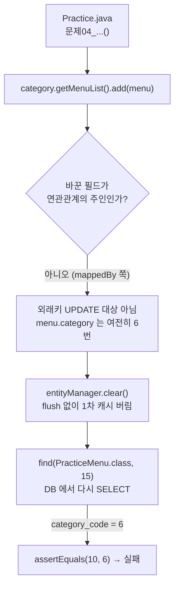
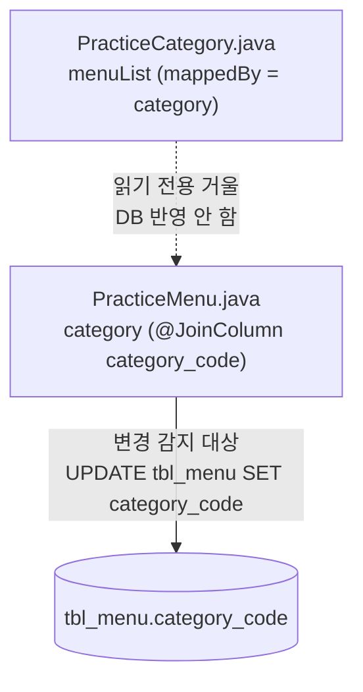
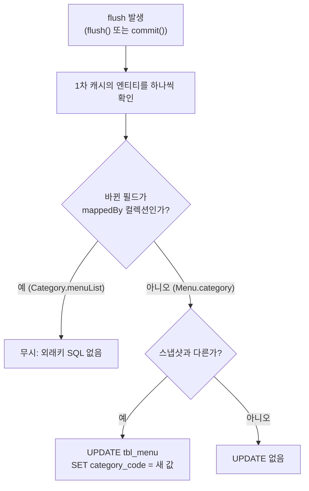

# Assosiacion Mapping

주로 단방향이 바람직함
(양방향은 잘 쓰지 않는 것이 좋음)

@ManytoOne의 속성
fetch : EAGER (첫 조회 시점에 바로 가지고 옴)

lazy (데이터를 가지고 올 때 전부 다 가져오지 않는다)

@ManyToOne
@JoinColumn(name = "category_code")
private Category category;

<실제 조인을 한다는 것이 아니라 스프링에 선언하는 것>

## 객체 그래프 탐색의 전략이 두 개 : lazy, eager


일반적인 설정에서는 fetch옵션을 lazy로 설정한다. 


---

## 🧪 Practice 문제04 — 주인이 아닌 쪽의 목록만 바꾸면 외래키가 바뀔까? → ❌ 실패

> 파일: `04_SpringBoot/04_JPA/chap03-association-mapping-lecture/src/test/java/com/bear/practice/Practice.java`
> 엔티티: 같은 패키지의 `PracticeCategory.java`, `PracticeMenu.java`
> 실행하지 않았고 **손으로 추적**했다. 15번 메뉴·10번 카테고리 값은 `sql/00_02_DB_SCRIPT.sql` 을 막 실행한 상태(번호가 1부터)라고 가정했다.

```java
PracticeCategory category = entityManager.find(PracticeCategory.class, 10);
PracticeMenu menu = entityManager.find(PracticeMenu.class, 15);

category.getMenuList().add(menu);   // 주인이 아닌 쪽(List)만 바꿈
entityManager.clear();              // flush 없이 1차 캐시 비움

PracticeMenu foundMenu = entityManager.find(PracticeMenu.class, 15);
assertEquals(10, foundMenu.getCategory().getCategoryCode());
```

실패 메시지 (예상): `expected: <10> but was: <6>` → 15번 메뉴(죽방멸치튀김우동)는 DB 에서 여전히 6번 카테고리다.

---

### 1단계 (개괄) — 실패 이유 두 가지

#### 설명

1. **연관관계의 주인이 아닌 쪽을 바꿨다.**
   - 외래키 `category_code` 는 `tbl_menu` 에 있다. 그래서 이 컬럼을 관리하는 쪽(**연관관계의 주인**)은 `PracticeMenu.category` 다 (`@ManyToOne` + `@JoinColumn(name = "category_code")`).
   - `PracticeCategory.menuList` 에는 `@OneToMany(mappedBy = "category")` 가 붙어 있다. `mappedBy` = "외래키는 저쪽(`PracticeMenu.category`)이 관리하니, 나는 **읽기 전용 거울**이다" 라는 뜻이다.
   - JPA 는 UPDATE 를 만들 때 **주인 쪽 필드만** 본다. `menuList.add(menu)` 는 자바 List 에 원소 하나를 넣었을 뿐, `menu.category` 는 그대로 6번이다 → 바뀐 것이 없으니 UPDATE 를 만들 이유가 없다.
2. **flush / commit 없이 `clear()` 했다.**
   - 설령 주인 쪽을 바꿨더라도, 트랜잭션도 flush 도 없이 `clear()` 하면 1차 캐시와 스냅샷이 통째로 버려진다 → 변경 감지할 기회 자체가 없다.

비유: 학생 명부(외래키)는 **담임 선생님 출석부(Menu.category)** 에만 적힌다. 동아리 회장이 자기 메모장(Category.menuList)에 "이 학생 우리 반"이라고 적어도, 출석부는 그대로다. 게다가 이 테스트는 메모장을 제출(flush)하기 전에 찢어 버렸다(clear).

#### 다이어그램



1. 주인이 아닌 `menuList` 만 바꿨으므로 외래키를 바꿀 근거가 없다.
2. `clear()` 로 영속성 컨텍스트가 비워진다. SQL 은 하나도 나가지 않았다.
3. 다시 조회하면 DB 의 원래 값(6)이 온다.

#### 실행 예시 (손으로 추적)

```text
find(PracticeCategory, 10)  → SELECT ... FROM tbl_category WHERE category_code = 10
find(PracticeMenu, 15)      → SELECT ... FROM tbl_menu ... (category 는 EAGER 라 6번 카테고리도 함께)
menuList.add(menu)          → SQL 없음 (menuList 를 처음 쓰는 순간 지연 로딩 SELECT 1번은 나갈 수 있음)
clear()                     → SQL 없음
find(PracticeMenu, 15)      → SELECT 다시 실행 → category_code = 6
assertEquals(10, 6)         → AssertionFailedError
```

- 콘솔에 **UPDATE 가 한 줄도 없다**는 것이 핵심 증거다.

---

### 2단계 (파일별 흐름) — 어느 파일의 어느 필드가 외래키를 쥐고 있나

#### 설명

| 파일 | 필드 | 어노테이션 | 역할 |
| --- | --- | --- | --- |
| `PracticeMenu.java` | `category` | `@ManyToOne` + `@JoinColumn(name = "category_code")` | **연관관계의 주인** → `tbl_menu.category_code` 를 INSERT/UPDATE 한다 |
| `PracticeCategory.java` | `menuList` | `@OneToMany(mappedBy = "category")` | **주인 아님** → 조회용. 값을 바꿔도 DB 에 반영 안 됨 |

- `mappedBy = "category"` 의 `"category"` 는 **`PracticeMenu` 클래스의 필드 이름**이다. "내 정보는 `PracticeMenu.category` 에 매핑돼 있다"는 뜻.
- 테이블 쪽에서 보면 이유가 더 분명하다: `tbl_category` 에는 메뉴 목록 컬럼이 없다. 1:N 관계의 외래키는 항상 **N 쪽 테이블**(`tbl_menu`)에 있으니, 주인도 보통 N 쪽(`@ManyToOne`)이 된다.

#### 다이어그램



1. 점선: `menuList` 는 `PracticeMenu.category` 를 **비춰 보기만** 한다.
2. 실선: `PracticeMenu.category` 가 바뀌어야 flush 때 `tbl_menu.category_code` 가 바뀐다.

#### 실행 예시 — 문제05 와 나란히 비교

| | 문제04 | 문제05 |
| --- | --- | --- |
| 바꾼 쪽 | `category.getMenuList().add(menu)` (주인 아님) | `menu.setCategory(category)` (주인) |
| 트랜잭션 | 없음 | `begin()` |
| flush | 없음 | `flush()` |
| 콘솔 UPDATE | 없음 | `update tbl_menu set category_code=? ... where menu_code=?` |
| 결과 | ❌ 실패 (6) | ✅ 성공 (10), 마지막 `rollback()` 으로 DB 는 원래대로 |

---

### 3단계 (내부 동작) — flush 때 Hibernate 가 무엇을 비교하나

#### 설명

- flush 때 Hibernate 는 1차 캐시의 각 엔티티를 스냅샷과 비교한다(변경 감지). 이때 **`mappedBy` 가 붙은 컬렉션은 비교 대상에서 빠진다** — 외래키를 쓰는 SQL 을 만들지 않는다.
- `PracticeMenu` 의 스냅샷에는 `category = 6번 카테고리` 가 들어 있다. 문제04 에서는 `menu.category` 를 건드리지 않았으므로 스냅샷과 같다 → UPDATE 없음.
- 문제04 는 그나마 flush 도 없다: `clear()` 가 1차 캐시와 스냅샷을 버리므로 비교 단계까지 가지도 못한다.
- **양방향에서 지켜야 할 규칙**: 주인 쪽(`menu.setCategory(category)`)을 반드시 바꾸고, 메모리 안의 객체끼리도 맞도록 반대쪽(`category.getMenuList().add(menu)`)도 같이 바꾼다. 둘을 한 번에 하는 편의 메서드(`Menu.changeCategory(...)` 같은)를 만들어 두는 경우가 많다. 수업 메모의 "주로 단방향이 바람직함"도 이런 관리 부담 때문이다.

#### 다이어그램



1. flush 가 일어나야 비교가 시작된다 (문제04 는 여기서부터 막힘).
2. `mappedBy` 컬렉션의 변경은 외래키 SQL 로 바뀌지 않는다.
3. 주인 필드가 스냅샷과 다를 때만 UPDATE 가 만들어진다.

#### 실행 예시 — 바꿔 보면 어떻게 될까 (손으로 추적)

- `menuList.add(menu)` 뒤에 트랜잭션을 열고 `flush()` 를 넣어도 → 여전히 UPDATE 없음, 실패. (원인 1 이 남아 있음)
- `menu.setCategory(category)` 로 바꾸고 `clear()` 만 하면 → flush 가 없어서 버려짐, 실패. (원인 2 가 남아 있음)
- `begin()` → `menu.setCategory(category)` → `flush()` → `clear()` → 조회 → 성공. (= 문제05)
